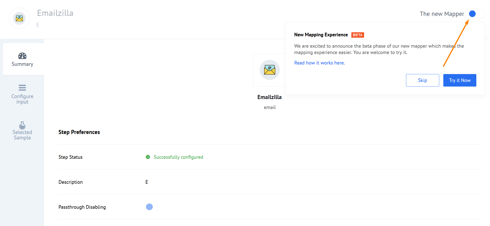
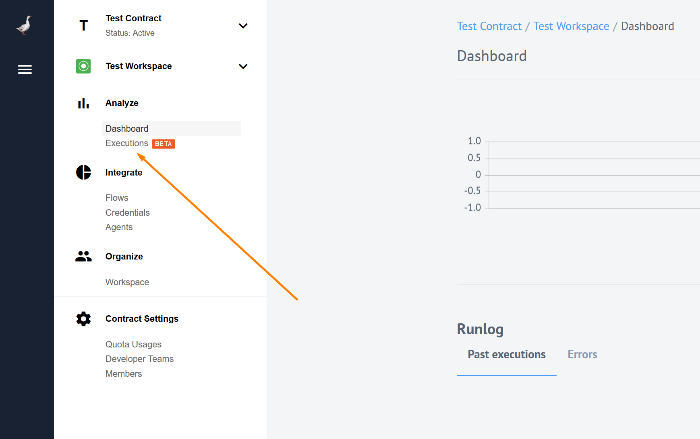
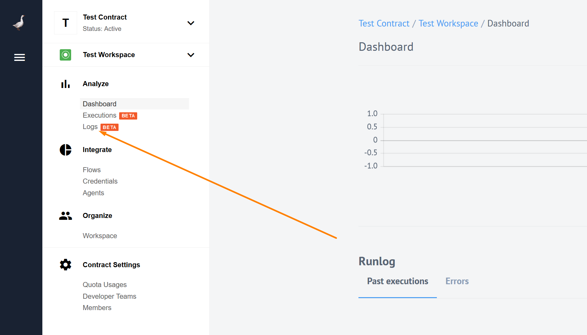
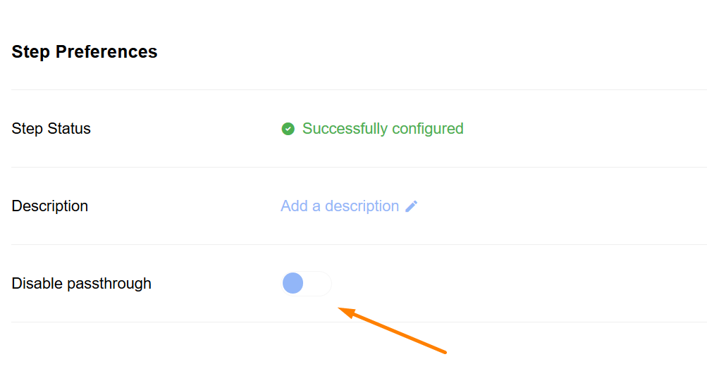
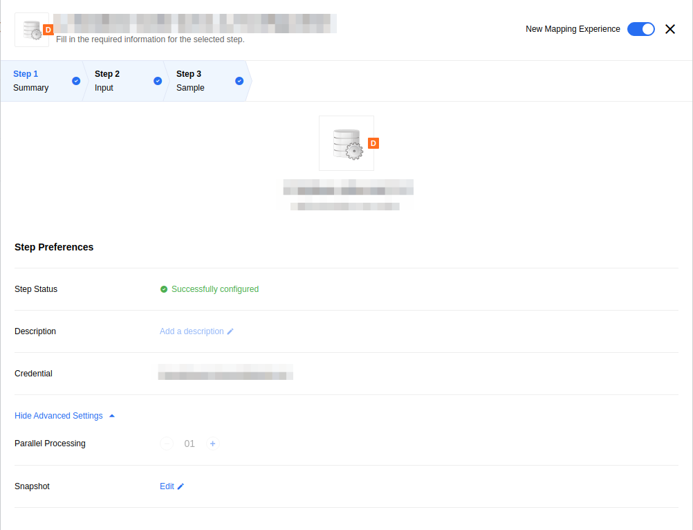
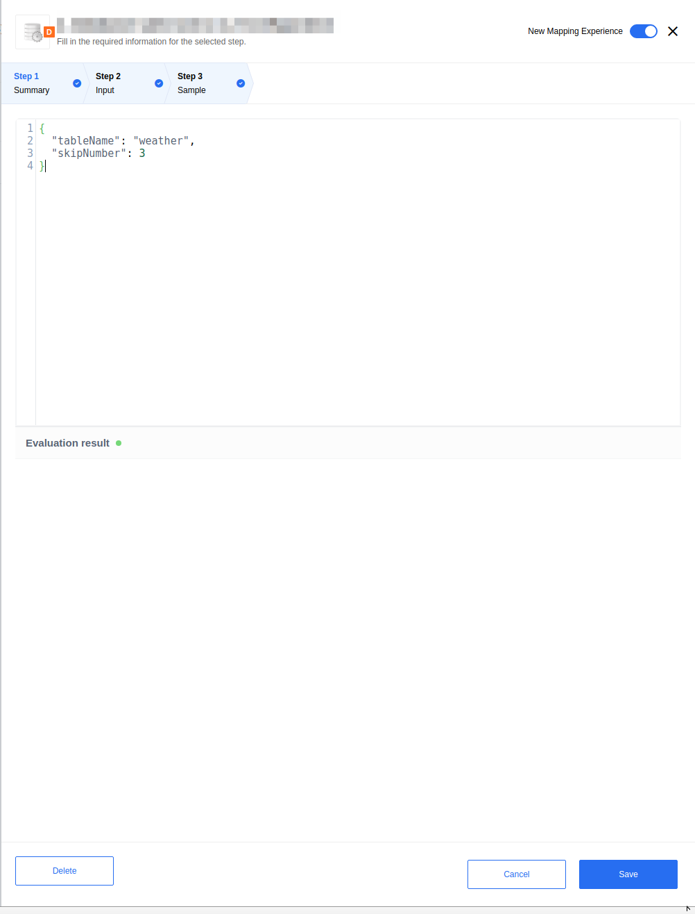
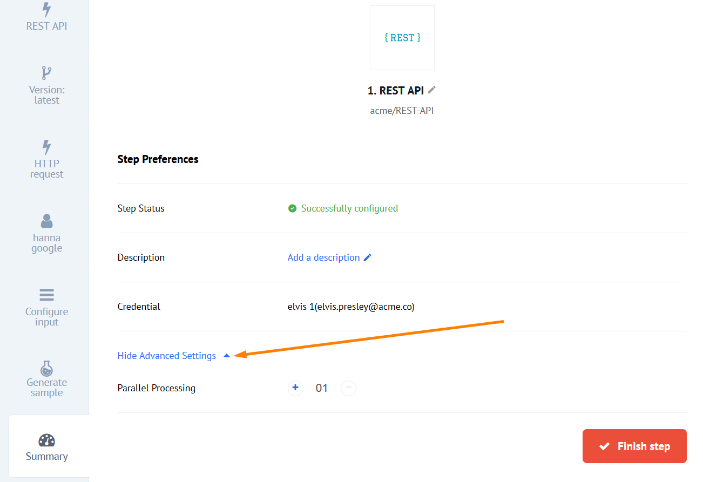
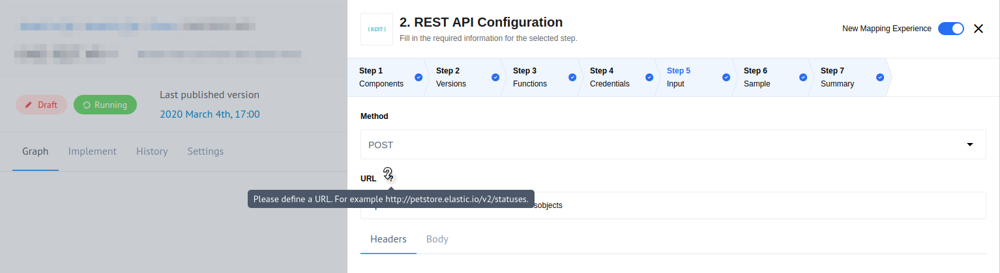
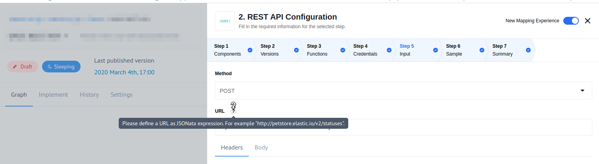

## Product update - v20.03

**Released: 2020-01-16**

*   [Features](#features-v2003)
*   [Improvements](#improvements-v2003)
*   [Fixed Bugs](#fixed-bugs-v2003)
*   [Components](#components-v2003)

### Features (v20.03)

#### New UI for mapper (v20.03)

Introducing [new mapper UI](/guides/new-mapper). This feature is still in beta.
You can use the switcher in the menu to try it out:



#### New Executions page (v20.03)

Introducing [Executions page](/getting-started/executions) where all the executions
based on processed data are listed. You can access it via the Navigational menu:



### Improvements (v20.03)

Handlebars are not supported any more. You can only use `"default_mapper_type":"jsonata"` in your integration Flows.

### Fixed Bugs (v20.03)

*  **FIXED** - bug where the `+` sign in email address would crash API. Not any more.
*  **FIXED** - bug which prevented pushing the same Component version into two different Tenants using the same repository name.

### Components (v20.03)

#### [SAP R3 Component](/components/sap-r3/) (v20.03)

*  **NEW** - introducing `RFC Server` trigger. It is a generic trigger which gives possibility to receive RFC calls from the SAP ECC platform.

#### List of Upgraded Components (v20.03)

We upgraded 22 components to the latest Sailor version, to take advantage of the
new logger, as well as to the new `Docker` build type:

*   AWS S3 Component
*   Batch Component
*   Component with 3 scheduled executions
*   Configuration Component
*   Content-Based Router Component
*   CSV Component
*   Exact Online Component
*   Filter Component
*   Google Spreadsheets Component
*   Handshake Component
*   Heartbeat Component
*   MailChimp Component
*   Petstore API (Node.js) Component
*   PostgreSQL Component
*   REST API Component
*   Salesforce Component
*   SFTP Component
*   Sphere.io Component
*   Splitter Component
*   Timer Component
*   Transformation Component
*   Zoho Subscriptions Component

## Product update - v20.07

**Released: 2020-02-13**

*   [Features](#features-v2007)
*   [Improvements](#improvements-v2007)
*   [Fixed Bugs](#fixed-bugs-v2007)
*   [Components](#components-v2007)

### Features (v20.07)

#### New Logs Page (v20.07)

You can now see all the logs from one workspace on the dedicated logs page,
located near the executions page in analyze section of the navigational menu:



While the most important logs are seen on the [executions](/getting-started/executions)
page, we decided no to spam you with everything else, and created a special page
for all the logs. The new page lists **all the logs for all the flows in the current workspace**.
Here you can filter the list by flow name, time, log level or use in-built
search to find the logs you were looking for. For more details check our
[logs page](/getting-started/logs-page).

As a back-end to the logs page we are introducing a new API endpoint (still experimental)
to request the same logs in the workspace. More about that in the
[Retrieve logs API endpoint](#retrieve-all-workspace-logs) section.

#### Retrieve all Workspace logs (v20.07)

As a back-end to the logs page we have a new, **still experimental** API endpoint `v2/logs`.
You can use this endpoint to request the same logs you see in the new logs page.

Here is the list of filters you can use with `v2/logs` endpoint:

*   `workspace_id`(required) -	The Workspace identifier
*   `flow_ids[]` - Flow identifier
*   `from` - Start Date of the period in `ISO 8601` format (`2020-01-12T14:50:42.215Z`)
*   `to` - End Date of the period in `ISO 8601` format (`2020-01-14T15:00:45.000Z`)
*   `search` - String to search in logs (searching string is wrapped by tag)
*   `offset` - Number of items to skip from the beginning (defaults to 0)
*   `limit`	- Number of items to return (**defaults is 100**)
*   `levels[]` - The logs level (1 - None, 10 - trace, 20 - debug, 30 - info, 40 - warn, 50 - error, 60 - fatal)

For more information about the endpoint visit our [API reference documentation]({{site.data.tenant.apiDocsUri}}/v2#/logs/get_logs).

### Improvements (v20.07)

#### New Mapper further improvements (v20.07)

You can now switch between Integrator & Developer modes in the new mapper without
losing any data that you have entered. However, if the root of the JSONata
expression is a function, switching to Integrator mode is not possible since the
Integrator mode has no functions support.

#### Disable passthrough (v20.07)

For components, which use sailor version 2.6.0 and higher, you can now disable
passthrough during the flow creation/editing via the UI:

.

#### OAuth2 for REST API component (v20.07)

Now you can use OAuth2 authentication method with the REST API component. Select
OAuth2 as credential type. There are four mandatory fields (`client_Id`,
`client_secret`, `auth_uri`, `token_uri`) and two optional (`scopes` and `additional parameters`).

### Fixed Bugs (v20.07)

*   **FIXED** - When your component descriptor (`component.json`) had an empty triggers object it would have appeared in the triggers selection during the flow design but not usable at all. **Now we will not show that empty trigger of yours, you are welcome.**
*   **FIXED** - When working in the Developer mode of the mapper, while inputting a data you refreshed the screen or your browser session had expired, the data would have been lost. **Now your data is saved while you type.**

### Components (v20.07)

#### [AWS S3 Component](/components/aws-s3/) (v20.07)

*   **NEW** - introducing trigger `Get New and Updated S3 Objects` (aka Files). Polling By Timestamp.
*   **IMPROVED** - will not create an attachments that are too big. Before writing any files from S3 server to Steward, the size of the file will be checked. If it is above the threshold, an error will be emitted and no data transferred to Steward.
*   **IMPROVED** - `Get filenames` action now returns any number of files. It was limited to 1,000 before.
*   **IMPROVED** - error handling of `Get filenames` and `Write` actions
*   **FIXED** - Invalid response on non-deleted file in Delete file action

#### [REST API Component](/components/rest-api) (v20.07)

*   **NEW** - implementing new `OAuth2` authentication strategy
*   **IMPROVED** - added a possibility to record HTTP Body in emitted error when encountering an HTTP failure
*   **IMPROVED** - all the results that are non-JSONObject are now to be wrapped into JSON Object: `{'result': %message%}`.

#### [OpenAPI Component](/components/open-api/) (v20.07)

Introducing OpenAPI component for the platform.

*   **NEW** - introducing action `Make request`
*   **NEW** - implementing new `OAuth2` authentication strategy

#### [Salesforce Component](/components/salesforce/) (v20.07)

*   **IMPROVED** -  Caching is now supported for `Lookup Objects` and `Lookup Object (at most 1)` actions
*   **FIXED** - bug in the `Query` action where the first response object was being sent multiple times instead of sending actual response objects

#### [SugarCRM Component](/components/sugarcrm/) (v20.07)

A major update for the component:
*   **NEW** - introducing actions `Query` and `Lookup Objects`
*   **IMPROVED** - Update `Lookup Objects` and `Upsert` actions to support binary attachments
*   **IMPROVED** - Update the component to the latest Sailor
*   **IMPROVED** - Update the component to the `docker` build type

#### [Splitter Component](/components/splitter) (v20.07)

*   **FIXED** - Fix a bug when the component did not await correctly when emitting data

#### List of Upgraded Components (v20.07)

We upgraded 9 components to the latest Sailor version, to take advantage of the
new logger, as well as to the new `Docker` build type:

*   MSSQL Component
*   Quickbooks Component
*   Webhook Component
*   Code Component
*   ZIP Component
*   Simple Trigger Component
*   XML Component
*   Shopware Component
*   Request Reply Component

## Product update - v20.11

**Released: 2020-03-12**

*   [Features](#features-v2011)
*   [Improvements](#improvements-v2011)
*   [Fixed Bugs](#fixed-bugs-v2011)
*   [Components](#components-v2011)

### Features (v20.11)

#### Snapshot Management UI (v20.11)

In the Flow UI you can now view and edit snapshot of the trigger. Snapshot management
is accessed via *Advanced Settings* in Step summary:



Then you get to snapshot manager itself:



#### Vertical Scaling (v20.11)

You can now use *Advanced Settings* section in *Step Summary* tab to configure prefetch.

> **Note:** the changes will be applied after clicking the *Finish step* button.



### Improvements (v20.11)

#### Errors Retention Policies (v20.11)

There is now a limit that defines the maximum number of errors we list for a Flow.
If the limit is reached, no new errors are listed for the given Flow anymore.
This new limit will protect you from the "chatterbox" Flows that tend to spam too much.

New `MAX_ERROR_RECORDS_COUNT` environment variable was added. If the amount of
errors per Flow gets higher then `MAX_ERROR_RECORDS_COUNT` value, we remove old
error records and show corresponding notification in UI.

Also, we added a new k8s CronJob `remove-excess-error-records`. This job is
clearing oldest flow error records if they are exceeding limit. The default limit
is `1000` records per Flow, and is set by `MAX_ERROR_RECORDS_COUNT` environment variable.

#### Toggle File Conversion on Webhook (v20.11)

Automatic conversion of raw XML files on Webhook is toggled in *component.json*
with `consumesRawData` flag. If `true`, then Webhook will not convert incoming data to `JSON`.

#### Improved UI for RESTClient (v20.11)

Added better tool-tips for mapping modes in the new mapper.

- Integrator mode:



- JSONata mode:




#### Tracking Flows Suspension (v20.11)

**INTERNAL** - `Flow Suspended` was added to the segment.io, so we can better track
Flows suspension process.

#### Step Message Prefetch Count (v20.11)

You can now configure step message prefetch count through the API. We added a
new `prefetch` field as a parameter to `nodeConfig` section of the `/v2/flows`
endpoint. The mapper-step gets the same prefetch as the previous step.

**EXAMPLE:**

```
"attributes": {
        "nodes_config": {
            "step_1": {
                "prefetch": 4
            }
        }
    }
}
```

#### Logs Per Page (v20.11)

The default number of logs displayed per page is `200`. You can set this number to: `400`, `600`, `800` or `1000`.

#### Trigger Emails (v20.11)

New emails are sent in case of events of the following scales:

- [Developer Team](#developer-team-emails)
- [Contract](#contract-emails)
- [Workspace](#workspace-emails)

##### Developer Team Emails: (v20.11)

*   **Removing a member from a Developer Team**. Email sent to the removed member.

##### Contract Emails (v20.11)

*   **Contract suspended**. Emails sent to all members of the Contract.
*   **Removing a member from a contract**. Email sent to the removed member.
*   **Contract re-activated from suspension**. Emails sent to all members of the Contract.
*   **Contract removed**. Emails sent to all members of the Contract.

##### Workspace Emails (v20.11)

*   **Removing a member from a team**. Email sent to the removed member.
*   **Workspace removed**. Emails sent to all members of the Workspace.

### Fixed Bugs (v20.11)

*   **FIXED** - You now have graceful restart for tasks pod (`elasticio-sailor-nodejs@2.6.4` is required).
*   **FIXED** - OAuth2 Keys without `refresh_token` are now marked as invalid.
*   **FIXED** - The following UI rendering bugs:
    *   **Search property** functionality in metadata drop-down of new mapper works properly now.
    *   REST-API and Splitter Component fields work properly now.
    *   **Split Message By Array** action works properly in new and old mappers.
    *   Arrow-drop-down icon fixed.
    *   Search now works properly when you delete entered value.
    *   Filtering Logs by Flow name fixed.
    *   **Retry Error** functionality fixed.
    *   Fixed Navigational Menu pushing page out of the screen


### Components (v20.11)


#### [Batch Component](/components/batch/) (v20.11)

*   **FIXED** - bug with verify credentials

#### [Magento2 Component](/components/magento2/) (v20.11)

*   **NEW** - introducing an action to read and return the store config info
*   **NEW** - introducing action to add update to Sales Order
*   **NEW** - introducing action `Create Order`
*   **NEW** - added an option to **Make RAW Request** to not throw errors on 4XX & 5XX responses
*   **NEW** - added an option to **Make RAW request** to process an array of requests
*   **IMPROVED** - extended `Lookup Object By ID` to allow lookup of Orders By External ID
*   **IMPROVED** - added an option to `Get Objects Polling Trigger` for "Time stamp field to poll on"
*   **IMPROVED** - improved error messaging. HTTP status from now will also be showed along with error message
*   **IMPROVED** - adding support for Magento v 2.3.4 and removing support for v 2.2.x (as deprecated)

#### [REST-API Component](/components/rest-api/) (v20.11)

*   **NEW** - OAuth2 Keys without `refresh_token` will now be marked as invalid
*   **IMPROVED** - credential verification of OAuth2 credentials now checks validity of the `refresh_token` and emits an error in case it is not valid

#### [Salesforce Component](/components/salesforce/) (v20.11)

*   **NEW** - added Emit All feature for Query/Get New and Updated Objects Polling triggers
*   **NEW** - added an ability to hydrate linked objects in `lookup object` action
*   **IMPROVED** - delete Object Iteration 2 (Delete Object By Unique Criteria)
*   **IMPROVED** - `Lookup Objects ( at most 1 )` now works for date or date-time field types


#### [Splitter Component](/components/splitter/) (v20.11)

*   **IMPROVED** - Update version of Sailor used by the component
