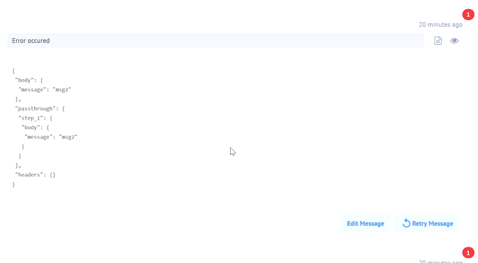
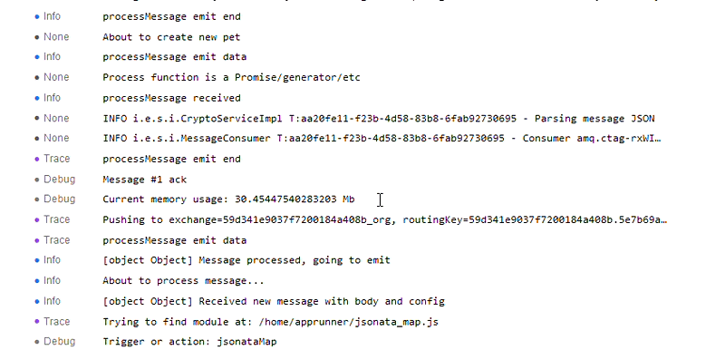
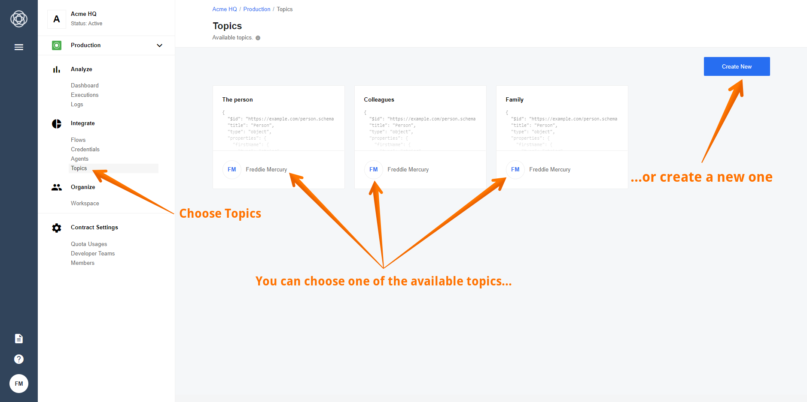
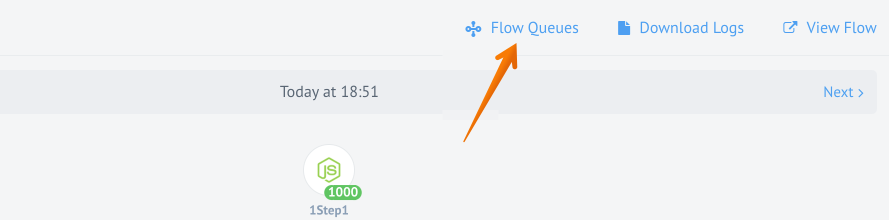
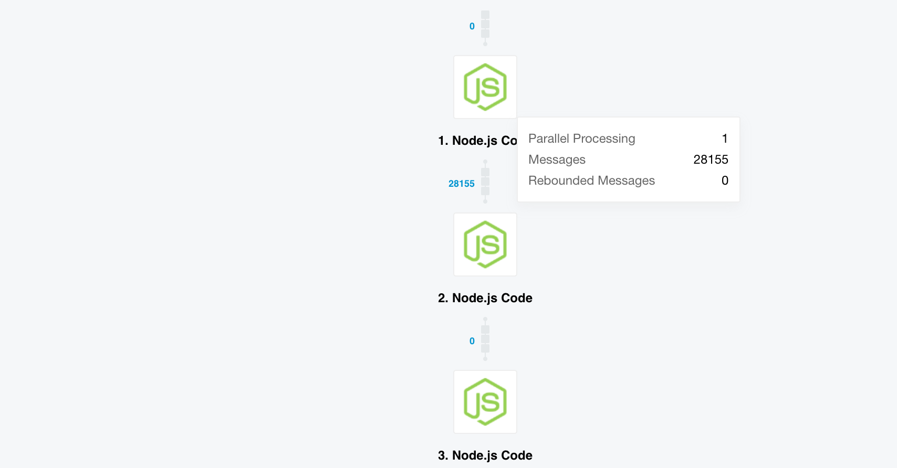

## Product update - v20.15

**Released: 2020-04-09**

*   [Features](#features-v2015)
*   [Improvements](#improvements-v2015)
*   [Fixed bugs](#fixed-bugs-v2015)
*   [Components](#components-v2015)

### Features (v20.15)

#### Help Links for Components (v20.15)
You can put help links on different stages of integration Flow creation:

- When creating and verifying new Credentials

- When selecting trigger or action of the Component

- When receiving Credentials errors

- When configuring Component fields and mapping, etc.

These links will lead to corresponding documents. You can find information on how to configure help links [here](/guides/configuring-help-links.html).

A Tenant admin may configure his Tenant with a `component_docs_base_url` attribute on the `/v2/tenants` API-endpoint. This configuration parameter is optional and if set, can be used in combination with relative URLs in *component.json* to construct a URL of the Component documentation. The value of `help.link` property may be an absolute or relative URL. If the URL is absolute, frontend navigates to that URL. If the URL is relative, the `component_docs_base_url` comes into play.

>**NOTE:** `component_docs_base_url` is for relative paths to component documents. If this URL is `docs.example.com/components` and *component.json* contains the following field `"documentation": "/examplecomponent"`, on a frontend we will use `docs.example.com/components/examplecomponent` as a link to the corresponding documentation. `attributes.component_docs_base_url` in Tenant model is an optional parameter. If this property is not set, relative URLs won't be displayed. If set, please make sure `{{component_docs_base_url}}/getting-started/credential.html` page exists.

New API docs can be found [here]({{site.data.tenant.apiDocsUri}}/v2#/tenants/post_tenants).

##### Configuring Credentials Help Messages (v20.15)
Update corresponding *component.json* by adding `help: {description: ..., link: ...}` property into:
- `credentials`
- `credentials.fields[field]`

##### Configuring Function Help Messages (v20.15)
Update corresponding *component.json* by adding `help: {description: ..., link: ...}` property into:
- `actions[action]`
- `triggers[trigger]`

##### Configuring Mapper Fields Help Popup (v20.15)
You will now see help icons in the new mapper. They will appear if the particular property in the metadata provides enough information:

- If the property has examples field, we display the following text in the hep: “Here are some example values accepted by this field: `X, Y, Z`”, `X, Y, Z` being the elements in the examples array.

- If the property is optional and has the default field, we display the text: "This field is optional. If you don’t provide any value it will be filled with `X`", if `default=X`

- If the property is of `enum` type, we display the following text in the help: “This field accepts a fixed set of values only. Following values are allowed: X, Y, Z” where X, Y, Z are the values of the `enum`

- A combination of the abovementioned cases is allowed

Update corresponding *component.json* by adding `"required": true/false`, "`examples": ["the array of examples values"]`, `"enum": ["the array of enum values"]`, `"default": "this will displayed in optional field if you don’t provide any value there"` properties into `metadata.in.properties.[property]`.

#### emailTemplates (v20.15)
Added new `email_templates` attribute to `/v2/tenants` endpoint:

```
{
    templateName: true | false
}
```

The attribute allows you to enable and disable various automatic Platform emails. Related new API docs can be found [here]({{site.data.tenant.apiDocsUri}}/v2#/tenants/post_tenants) and [here](https://on-prem.elastic.io/white-label/platform-emails/templates).


#### Edit Message Before Retrying Error (v20.15)
If an error occurs due to bad inputs or a misconfiguration, you can now edit those inputs and submit the record for re-processing at the point of failure. This way you don’t have to process the entire message from the beginning of the Flow:



#### Static CSS Classes (v20.15)
You can now create your own JSS styles based on static CSS classes.

#### $getPassthrough() function (v20.15)

We introduced the `$getPassthrough()` functionality, which allows you to avoid hardcoded `elasticio` mentions while refering the passthrough step. Now you can use `$getPassthrough().step_1.body.value` instead of `elasticio.step_1.body.value`.

>**NOTE:** The following Components must be be updated:

- [REST-API](/components/rest-api/)
- [Router](/components/router/)
- [Filter](/components/filter/)
- [Splitter](/components/splitter/)
- [JSONata Transform](/components/jsonata/)


### Improvements (v20.15)

#### Link Log with Associated Thread (v20.15)
You can go from the record on the Logs Page directly to the associated thread now. In case the log record contains `thread_id`, you will see "3 dots" icon, which appears on hover. Click it and it presents a link that opens the execution you need:



#### Threads Page Performance (v20.15)
Improved performance of `getThread`. Instead of doing `25` requests it does `1` that takes about 30% of the time of `listThreads`. Thus, the overall performance is `3` times better.

#### Raw Number Values (v20.15)
Number values can now be entered into number fields without conversion into string. The same principle works with Boolean values in Boolean fields.


### Fixed bugs (v20.15)
* If not specified during Tenant creation, `css_enabled` attribute will be `false` by default.

* Fixed *Continue* button in the new mapper for Salesforce Component.

### Components (v20.15)

#### [Filter Component](/components/filter) (v20.15)

*   **IMPROVED** - added support for JSONata function `$getPassthrough()`
*   **IMPROVED** - added support for JSONata function `$getFlowVariables()`

#### [JSONata Transform Component](/components/jsonata) (v20.15)

*   **IMPROVED** - added support for JSONata function `$getPassthrough()`
*   **IMPROVED** - added support for JSONata function `$getFlowVariables()`

#### [Microsoft Dynamics NAV 2015 Component](/components/microsoft-dynamics-nav-odata/) (v20.15)

*   **NEW** - introducing action `Delete Object`

#### [Microsoft OneDrive Component](/components/onedrive/) (v20.15)

Introducing new Component for Microsoft OneDrive.

*   **NEW** - introducing action `Create Folder`
*   **NEW** - introducing action `Upload/Replace File`
*   **NEW** - introducing action `Download/Lookup File By Path`
*   **NEW** - introducing action `Delete File`
*   **NEW** - introducing trigger `Get New And Updated Files`

#### [REST API Component](/components/rest-api/) (v20.15)

*   **IMPROVED** - added support for JSONata function `$getPassthrough()`
*   **IMPROVED** - added support for JSONata function `$getFlowVariables()`
*   **FIXED** - "No error and no response generated in case of unsupported Content Type" bug
*   **FIXED** -  `refresh_token` now always checked during OAuth2 Credentials verification

#### [Router Component](/components/router) (v20.15)

*   **IMPROVED** - added support for JSONata function `$getPassthrough()`
*   **IMPROVED** - added support for JSONata function `$getFlowVariables()`

#### [Splitter Component](/components/splitter) (v20.15)

*   **IMPROVED** - added support for JSONata function `$getPassthrough()`
*   **IMPROVED** - added support for JSONata function `$getFlowVariables()`

#### [Salesforce Component](/components/salesforce/) (v20.15)

*   **IMPROVED** - `Get New and Updated Objects` Polling Trigger now supports parent related object (`__r`)

#### [XML component](/components/xml/) (v20.15)

*   **IMPROVED** - logs improvement for `XML to JSNON` action

#### [Dropbox Component](/components/dropbox/) (v20.15)

Introducing new Component for Dropbox.

*   **NEW** - introducing action `Create Folder`
*   **NEW** - introducing action `Get File By Provided Path`
*   **NEW** - introducing action `Delete File By Provided Path`
*   **NEW** - introducing action `Upsert (Create Or Replace) File By Provided Path`

#### [PostgreSQL Component](/components/postgresql/) (v20.15)

*   **IMPROVED** - split `Connection String` into different fields for convenience
*   **IMPROVED** - removed sensitive data from logs

## Product update - v20.19

**Released: 2020-05-07**

*   [Features](#features-v2019)
*   [Improvements](#improvements-v2019)
*   [Fixed Bugs](#fixed-bugs-v2019)
*   [Components](#components-v2019)

### Features (v20.19)

#### Array-to-Array Mapping (v20.19)

You can now map array fields with the graphical UI using "New Mapping Experience".
Mapping process is similar to a mapping of an object field, with few restrictions:

*   You can map properties from only one array throughout array's children fields
*   JSONata mode is disabled for an array's children fields

#### Dynamic Flow Control (Sailor version: `2.6.7` required) (v20.19)

When you retry erroneous messages, they get marked with `retry=true` header, so
lookout doesn't write data record.

Also, now sailor retries publishing messages to next step infinitely, for those
cases when the next queue is overloaded. Retries will happen with exponential
back-off. For example, if it starts with retry in 5 seconds, the next will be in
10, then 20, then 40, then 80 seconds, etc. The maximum delay is configurable with
an environment variable. By default, there is no limit to retries.

The following variables control the retry process:

*   `AMQP_PUBLISH_RETRY_DELAY`: 100 ms
*   `AMQP_PUBLISH_RETRY_ATTEMPTS`: Infinity
*   `AMQP_PUBLISH_MAX_RETRY_DELAY:` 5 minutes.

#### Pub-Sub API (v20.19)

You can now use pub-sub topics via the new API endpoints:

*   `POST /v2/workspaces/:id/topics` - creates a topic in the Workspace, requires `WORKSPACE.TOPIC.CREATE` permission
*   `GET /v2/workspaces/:id/topics` - lists topics in the Workspace, requires `WORKSPACE.TOPIC.GET` permission
*   `GET /v2/workspaces/:id/topics/:id` - get topic in the Workspace, requires `WORKSPACE.TOPIC.GET` permission
*   `PATCH /v2/workspaces/:id/topics/:id`- update topic in the Workspace, requires `WORKSPACE.TOPIC.EDIT` permission
*   `DELETE /v2/workspaces/:id/topics/:id` - delete topic in the Workspace, requires `WORKSPACE.TOPIC.DELETE` permission.


Details can be found [here]({{site.data.tenant.apiDocsUri}}/v2#/topics).


### Improvements (v20.19)

#### Better Component Versions (v20.19)

You will now have the de-facto latest Component version set as default. Previously,
the default Component version was `Latest`, meaning the Platform checked for the
latest version. Now there is no automatic check, and the latest version at the
point of Flow creation is selected. If you need to set the current version, you
should manually select it from the list.

#### 10,000 Log Records Limit Set (v20.19)

The confusing "next" button on the last page of log records list is now disabled.
 If you hover the cursor on it, you'll see the new tool-tip that suggests you
 reduce your results number with filters.

#### Large Samples Visualization (v20.19)

Improvements:

*   Mapper `select items` filtering code moved to async worker
*   Mapper `select items` is now an async operation (async computed in ember)
*   Loader is displayed when filtering takes too long


### Fixed Bugs (v20.19)

*   Removed the strange "no notification" message on gitreceiver logs
*   Removed the console error that appeared when you change Component version
*   Letters `wiper-flow-suspended-due-to-queue-overflow` are sent again
*   Webhooks now don't insist on Content-Type for webhook POST actions when there is no body in the POST request


### Components (v20.19)

#### [Utility Component](/components/utility/) (v20.19)

*   **NEW** - introducing action `Convert Between Timezones`

#### [CSV Component](/components/csv/) (v20.19)

*   **NEW** - introducing action `write_attachment_from_json`
*   **NEW** - introducing action `write_attachment_from_array`
*   **IMPROVED** - added the Steward URL to the body of outgoing message

#### [XML Component](/components/xml/) (v20.19)

*   **IMPROVED** - revised `JSON to XML` action

#### [AppDirect Component](/components/appdirect/) (v20.19)

*   **FIXED** - "Credentials verification fails when Authenticate and then Verify, but not if just Verify" bug

#### [Splitter Component](/components/splitter/) (v20.19)

*   **NEW** - introducing action `Reassemble`

#### [Marketo Component](/components/marketo/) (v20.19)

*   **NEW** - introducing action `Describe Object`
*   **NEW** - introducing action `List Custom Objects`
*   **NEW** - introducing action `Lookup Objects`
*   **NEW** - introducing action `Bulk Import`
*   **NEW** - introducing action `Bulk Export`
*   **NEW** - introducing action `Lookup Activities`
*   **NEW** - introducing action `Upsert Objects By Unique Criteria`
*   **NEW** - introducing trigger `Get New Activities Polling`
*   **NEW** - introducing trigger `Get New Leads Polling`

#### [Soap Component Java](/components/soap/) (v20.19)

*   **IMPROVED** - Basic-AUTH for reaching out WSDL
*   **FIXED** - sorting order for configuration fields

#### [Pub-sub Component](/components/pub-sub/) (v20.19)

This is a new component with the following functions:

*   **NEW** - introducing trigger `Subscriber` with a dynamically configurable field for topics. This trigger receives the data of a certain type from a topic as an input to start a new execution of the flow.
*   **NEW** - introducing action `Publisher` with a dynamically configurable field for topics. This action published an event of a certain type to topic to be received by loosely coupled subscribers.

## Product update - v20.23

**Released: 2020-06-04**

*   [Features](#features-v2023)
*   [Improvements](#improvements-v2023)
*   [Fixed Bugs](#fixed-bugs-v2023)
*   [Components](#components-v2023)

### Features (v20.23)

We are happy to announce that our Executions and Logs pages graduated from the beta
stage to a full production. Thank you for all early adopters who provided the
valuable feedback. With your help we improved these pages immensely.

#### Topics UI (v20.23)

Introducing UI for publish-subscribe (pub-sub) messaging pattern to compliment the
[pub-sub API endpoints]({{site.data.tenant.apiDocsUri}}/v2#/topics)
already introduced last month. Using the new Topics UI you can create and modify
the topics. The UI is accessible from the main navigation > Integrate sub-section.



We have a [dedicated page you can dive in](/getting-started/topics) to read more
and start using the Topics feature in your integration patterns.

To help implement pub-sub pattern we have a **[dedicated pub-sub component](/components/pub-sub)**
which we recommend to use to along with the Topics feature.

#### Flow Message Queue UI (v20.23)

You have heard from us talking about how many messages were processed and how
many still in the messaging queue. This information was always hidden from you
under the wraps. Not anymore!

We introduce the new feature called **Flow Message Queue**. You can now see number
of messages in the queue for each of your flow steps. To access navigate to Executions,
select any active execution and look for the **Flow Queues** menu link along with
the Download Logs and View Flow links like in the picture below.



Click on link to navigate to a special page showing the current queue of this flow
to see how many messages are in each flow-step of your integration flow.



You can access the Flow Queues page from the Flow Designer and Flow-card menu
of general Flows page. However, the **Flow Queues are only available for actively running flows**.

You can also access the queue information using the `/v2/stats/queues/FLOW_ID`
API endpoint. More information is available from the
[API reference documentation]({{site.data.tenant.apiDocsUri}}/v2#/stats).

#### Java Sailor Update (v20.23)

We are releasing a new version of JAVA Sailor `3.1.0` which support a dynamic
flow control. More information is available from the `io.elastic:sailor-jvm`
[documentation pages](https://javadoc.io/doc/io.elastic/sailor-jvm/latest/index.html).


#### Secrets Management Service for OAuth (v20.23)

Introducing a new centralised service to handle the secrets and OAuth credentials.
We aim to replace the credential handling mechanism in the whole platform.

> Please Note: **The service is still in early implementation and experimentation stage and it is not implemented on any currently released components.**

This new service aims to solve the problem of outdated and invalid secrets/tokens.
Here is the general approach for future component developments:

1.  Refreshing secrets/tokens are handled by the platform.
2.  Component can not and MUST not try to refresh token by itself, it should ask platform to do so.
3.  Component MUST ask platform for a valid value of secret every time it needs it. Caching is not recommended.
4.  When using this new service you MUST NOT use `this.emit('updateKeys')` mechanism.
5.  The `this.emit('updateKeys')` mechanism would still continue to co-exist until the deprecation of `Credentials` mechanism. It is still OK to use it for refreshing the `Credentials`.
6.  You MUST NOT use both `Secrets` and `Credentials` mechanisms at the same time in the same component.


### Improvements (v20.23)

#### Mapper fixed version (v20.23)

The mapper component now adheres the  general approach of fixed components. The
version of the component is fixed when you save the flow draft. To use a newer
version of the mapper component in your integration flow you must create a new
draft of your flow and publish it again.

#### Node.js Sailor 2.6.10 release (v20.23)

The new Node.js Sailor `2.6.10` is available. It adds support for the dynamic
flow control in the `return promise` interface in the Node.js Sailor. An update
of components using this interface and hoping to dynamically control the flow
messaging queues is highly recommended.

### Fixed Bugs (v20.23)

*   Fixes the problem when the dynamic metadata reloaded often during the flow-step configuration.
*   Fixes the problem when after series of random navigation through the flow-step design an error **Something technically Wrong** would appear making the flow in-recoverable.
*   Addresses the problem when by navigating forward and backwards without saving, in the flow-step design an error **Something technically Wrong** would appear making the flow in-recoverable.
*   Fixes the problem when the error retry in the executions page kept showing after a successful retry.


### Components (v20.23)

#### [MongoDB Component](/components/mongodb) (v20.23)

Introducing a new integration component for MongoDB interaction. Only action
functions are available. This means component can not be used in the first step of
integration flows. The component uses the new Node.js Sailor `2.6.7`.

*   **NEW** - introducing action `Aggregate` which calculates the aggregate values for the data in a collection or a view.
*   **NEW** - introducing action `Bulk Write` which takes an array of write operations and executes each of them.
*   **NEW** - introducing action `Delete By ID` which deletes document by ID.
*   **NEW** - introducing action `Delete By Unique Criteria` which deletes document by a Unique Criteria.
*   **NEW** - introducing action `Lookup By ID` which performs a lookup of document by ID.
*   **NEW** - introducing action `Lookup By Unique Criteria` which performs lookup (at most 1) Document By Unique Criteria.
*   **NEW** - introducing action `Lookup Plural` which performs lookup of many documents by a criteria.
*   **NEW** - introducing action `Upsert By ID` which upserts document by ID.
*   **NEW** - introducing action `Update Many` which updates documents in a collection.
*   **NEW** - introducing action `Upsert By Unique Criteria` which upserts document by a Unique Criteria.
*   **IMPROVED** - added the help-links to all the descriptions of the component.

#### [Marketo component](/components/marketo) (v20.23)

*   **NEW** - introducing action `Lookup Object (at most 1)` which performs lookup of one object.
*   **NEW** - introducing action `Delete Object By Unique Criteria` which deletes an object by Unique Criteria.
*   **UPDATED** - updated Sailor version to `2.6.7` to support dynamic flow control.

#### [Filter component](/components/filter) (v20.23)

*   **UPDATED** - updated Sailor version to `2.6.7` to support dynamic flow control.
*   **IMPROVED** - added JSONata expression when error is thrown by assertion for better debugging.
*   **IMPROVED** - added the incoming message when filter condition is true.
*   **FIXED** - the bug causing the message **Cannot read property `info` of undefined**.

#### [Google Spreadsheet component](/components/gspreadsheet) (v20.23)

*   **IMPROVED** - dynamic created fields based on sheets schema are now used in `Create/Add spreadsheet row` action.

#### [SFTP component](/components/sftp) (v20.23)

*   **NEW** - introducing action `Move File on SFTP`.
*   **UPDATED** - updated Sailor version to `2.6.7` to support dynamic flow control.
*   **FIXED** - the bug when the `Lookup Files` action tries to download many files.

#### [AWS S3 component](/components/aws-s3) (v20.23)

*   **NEW** - introducing action `Upsert S3 Object (aka File) by Key (aka ID/Filename)`.
*   **UPDATED** - updated Sailor version to `2.6.7` to support dynamic flow control.

#### [Pub-Sub component](/components/pub-sub) (v20.23)

*   **IMPROVED** - added the help-links to all the descriptions of the component.
*   **UPDATED** - updated Sailor version to `2.6.7` to support dynamic flow control.
*   **FIXED** - the issue when by changing the topic had no real effect.
*   **FIXED** - the problem with the dynamic select model and dynamic metadata.
*   **FIXED** - the issue when the Property ID was shown instead of the name in the metadata dropdown for trigger and action.

#### Updated Sailor version to 2.6.7 (v20.23)

For the following list of components only the Sailor version was updated to 2.6.7
to support dynamic flow control:

*   [AMQP component](/components/amqp)
*   [AWS SNS component](/components/aws-sns)
*   [Batch component](/components/batch)
*   [Code component](/components/code)
*   [CSV component](/components/csv)
*   [Email component](/components/email)
*   [Google PubSub component](/components/google-pubsub)
*   [Jsonata component](/components/jsonata)
*   [Mapper](/components/mapper)
*   [MsSQL component](/components/mssql)
*   [ODATA component](/components/odata)
*   [PostgreSQL component](/components/postgresql)
*   [Request-reply component](/components/request-reply)
*   [REST API component](/components/rest-api)
*   [Router component](/components/router)
*   [Simple Storage component](/components/key-value) (a.k.a Key-Value component)
*   [SOAP component](/components/soap)
*   [Splitter component](/components/splitter)
*   [Utility component](/components/utility)
*   [Webhook component](/components/webhook)
*   [XML component](/components/xml)
*   [ZIP/UnZIP component](/components/zip)
