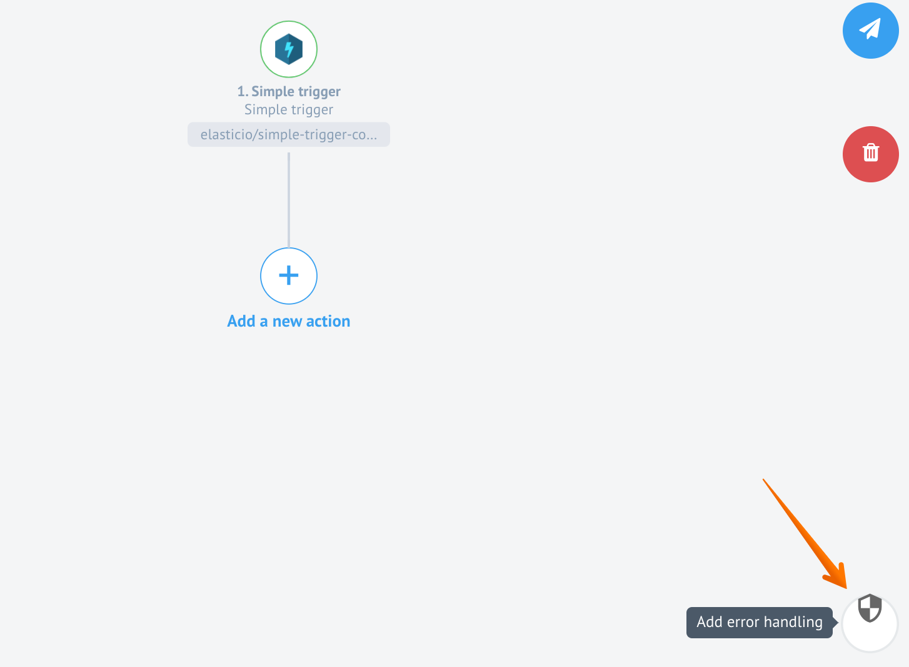
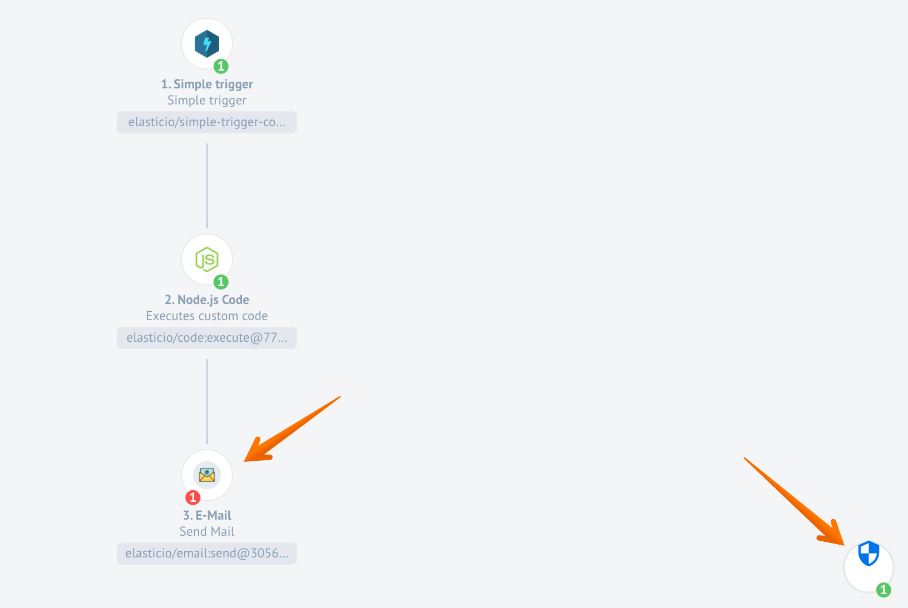

## Product update - v20.27

**Released: 2020-07-02**

*   [Features](#features-v2027)
*   [Improvements](#improvements-v2027)
*   [Fixed Bugs](#fixed-bugs-v2027)
*   [Components](#components-v2027)

### Features (v20.27)

#### Custom error handling in flows (v20.27)

> **Please Note, this feature is only available when the new mapper component
> with Sailor `2.6.13` version is installed in the system.**

We introduce a new concept for error handling in the integration flows. Now you
have a possibility to choose what to do with errors. In short you can handle
those errors by building a workflow to catch them and store them in a most
convenient way for you.

Before you would get error reports when you subscribe to receive them per email
or if you would constantly checking your flows for errors on the platform UI by
logging in.

Now you can do both of these if you still prefer it, but you can proactively handle
those errors and decide what should happen with these errors and who should handle
them.

To use and customise error handling choose the icon presented in the right bottom
of the flow designer page after you configure the first step in the flow.



You can choose to configure it right away or wait when you finish the flow design
and configure it to handle errors in one go since
**only one error handling is supported in this version**.

Here is how the completed flow with error handling would look. Note, it handled
the error in the third step.



In this example all errors in email components get redirected into a separate Google
spreadsheet document.

##### Preconditions (v20.27)

In case when your custom component is not using a system-wide mapper component
right before to map the fields, then it will not show in the component chooser
as a method to process your errors. **You can overcome this by upgrading your custom component Node.js Sailor to at least `2.6.13` version.**

At this moment the components which do not require mapper component input to
function would not show in the components list to choose.

##### Limitations (v20.27)

At the moment the Custom Error Handling works for limited use cases and errors.
For example it can not handle the following cases:

*   "Container failed to start" by request-reply as error handler. It causes request timeout on webhook.
*   "Container failed to start" original error messages.

The incoming metadata from the Custom Error Handling is hard-coded. It has the
following structure:

```json
{
    "error": {
        "message": "Error message",
        "name": "Error name",
        "stack": "Error stack trace"
    },
    "errorInput": {
      "properties": {
            "headers": { "header":"value" }
        },
        "content": {
            "headers": { "header":"value" },
            "body": {}
        }
    }
}
```


### Improvements (v20.27)

#### Secrets Management Service Improvements (v20.27)

We continue our improvements and developments of the New Secrets Management
service. In this round we made great improvements on authentication parameters.

##### `auth_uri` and `token_uri` for OAuth2 (v20.27)

Authentication clients for OAuth2 now support `auth_uri` and `token_uri` attributes
in credentials.

> **Please Note**: API-requests for auth-clients is different now. More iformation
> in [auth-clients-(experimental)](https://api.elastic.io/docs/v2/#auth-clients-(experimental))
> section of API documentation.

##### Handling token expiration (v20.27)

Secrets Management Service refreshes tokens 60 second earlier than
`exires_in` parameter record to ensure the stability of the connection.

##### `expires_in` taken from `token_expires_in` (v20.27)

Now when you create a new secret linked to `auth-client` with a parameter `token_expires_in`,
the parameter `expires_in` gets the value from the `token_expires_in` data.

#### Request-reply Response Code (v20.27)

From `1.1.0` version of [Request-Reply component](/components/request-reply) you
can add and configure the HTTP response code using the new **Response Code**
input field during the design phase. Response code is passed in the reply message
header. The default value is `200` by default.

### Fixed Bugs (v20.27)

*   Fixes the problem when newly created credentials would disappear and appear after UI refresh.
*   Addresses the problem with mapper UI when objects in arrays were impossible to modify.
*   Addresses the empty title problem in pub/sub topic schema generation.
*   Fixes several internal issues connected with the logs delivery delays to UI.

### Components (v20.27)

#### [Code component](/components/code) (v20.27)

*   **UPDATED** - Node.js Sailor was updated to `2.6.13`.

#### [Mapper component](/components/mapper) (v20.27)

*   **UPDATED** - Node.js Sailor was updated to `2.6.13`.

#### [Router component](/components/router/) (v20.27)

*   **UPDATED** - Node.js Sailor was updated to `2.6.13`.
*   **FIXED** - Problems with flow control.

#### [MongoDB Component](/components/mongodb) (v20.27)

*   **UPDATED** - component updated to use Node v14 and the dependencies are updated accordingly.
*   **UPDATED** - Node.js Sailor was updated to `2.6.10`.
*   **IMPROVED** - add Emit Batch Behavior to **Lookup Plural** action
*   **IMPROVED** - add Emit Behavior to **Aggregate** and **Lookup Plural** actions
*   **IMPROVED** - input field positions corrected using an order rather than a weight factor.

#### [Microsoft Dynamics CRM component](/components/msdynamics-crm/) (v20.27)

*   **NEW** - introducing new action **Query**.
*   **NEW** - introducing new action **Delete Object By ID**.
*   **NEW** - introducing new action **Bulk Create**.
*   **NEW** - introducing new action **Bulk Update**.
*   **NEW** - introducing new action **Bulk Delete**.
*   **NEW** - introducing new action **Lookup Objects**.
*   **IMPROVED** - new implementation **Upsert** action with image attachment support
*   **IMPROVED** - new implementation **Lookup Object** action with image attachment support

#### [Marketo component](/components/marketo/) (v20.27)

*   **FIXED** -  the bug when query string exceeds 8K characters
*   **UPDATED** - component updated to use Node v14 and the dependencies are updated accordingly.
*   **UPDATED** - component logo was updated
*   **IMPROVED** - More clearly report HTTP level failures

#### [SFTP Component](/components/sftp/) (v20.27)

*   **NEW** - introducing new action **Move File**.
*   **IMPROVED** - component performs better when trying to download large number of files.

#### [Google Spreadsheets](/components/gspreadsheet/) (v20.27)

*   **NEW** - introducing support for OAuth clients. Changed the environment variable naming accordingly.
*   **UPDATED** - Node.js Sailor was updated to `2.6.9`.
*   **UPDATED** - metadata for **add new row** action.

#### [Magento2 Component](/components/magento2/) (v20.27)

*   **NEW** - introducing new trigger **Bulk Extract**.
*   **NEW** - introducing new action **Lookup Objects**.
*   **NEW** - introducing new action **Lookup Set of Objects**.
*   **IMPROVED** - component now uses the new logger.
*   **IMPROVED** - replaces parameters in error messages when parameters are an object, not an array.

#### [Amazon AWS S3 Component](/components/aws-s3/) (v20.27)

*   **NEW** - introducing new action **Upsert File**.
*   **UPDATED** - component updated to use Node v14 and the dependencies are updated accordingly.
*   **IMPROVED** - verify Credentials now checks for access to buckets.

#### [SOAP Component](/components/soap/) (v20.27)

*   **IMPROVED** - input field positions corrected using an order rather than a weight factor.

## Product update - v20.31

**Released: 2020-07-30**

*   [Features](#features-v2031)
*   [Improvements and Updates](#improvements-and-updates-v2031)
*   [Fixed Bugs](#fixed-bugs-v2031)
*   [Components](#components-v2031)

### Features (v20.31)

#### New and compact flow header in UI (v20.31)

We are introducing a new header for the flow designer page to maximise the screen
real estate and separate the integration flow graph from the functional buttons.

The animation below shows all the functionality in one go.

{% include img.html max-width="100%" url="/assets/img/RN/2031/flow-header-an-v2.gif" title="Copy flow" %}

#### Copy flow between any workspaces (v20.31)

We are introducing a new functionality to copy flows from one workspace to the
another. **You must have at least Integrator level access in both workspaces for this to work.**
The new copy flow functionality behaves the following way:

*   You can copy your flow between two workspaces in the same contract. For example you would like to copy your flow from development to production workspace. No need to select the destination flow name.
*   If you select a destination workspace flow name then copy flow will create a new draft to this flow.
*   If you do not select the destination flow name a new flow with same name will be created in draft mode. You need to choose the credentials and publish the draft.
*   Copy your flow between two workspaces between different contracts if:
    *   You have access to both contracts/workspaces and
    *   Components used in the flow are accessible in both contracts.

{% include img.html max-width="100%" url="/assets/img/RN/2031/copy-flow-an.gif" title="Copy flow" %}

In our back-end we have introduced API endpoints to use with copy flow functionality.
These endpoints are still in active development and should be regarded as experimental.
Check our [API-docs documentation pages](https://api.elastic.io/docs/v2/#copy-flow-(experimental)) for more details.

#### New VPN Local Agent (v20.31)

**Introducing a new VPN Agent**. It is using а VPN tunnel specifically configured to access any
local resource in your local environment. It could be any local database or CRM
to which you would rather restrict access from outside world but still need
to query for a data. Agents are available to configure by visiting the Agents
page as usual. **[The dedicated VPN Agents page](/guides/vpn-agent) has more details about this.**

Starting from this release **the old Local Agents will be deprecated**. You can
still visit and configure your agents by removing the `/vpn` part of the address
while visiting the VPN Agents page.

#### Support for Large messages (v20.31)

We are introducing a new functionality called **Lightweight messages**. The main
idea of this functionality is to reduce the load of messaging queue by sending
the Lightweight messages through it. By reducing the load on messaging queue we
reduce the processing time significantly and reduce or prevent out of
memory errors during the data exchange between the steps.

Our aim for this realisation was to make sure the large size messages and
attachments bypass the messaging queue all together. Instead of passing large messages
through messaging queue we introduced an internal service which would temporarily
store large message and provide an ID of these messages instead. These IDs, in turn, get
sent through the messaging queue - not the big chunks of data.

If the step requires stored data it communicates with the storage directly, not
through the messaging queue.

> The Lightweight messaging is already implemented at system level. If you would like
> to use this functionality you must update the sailor version in your
> components to Node.js Sailor to `2.6.14` version and Java Sailor to at least `3.2.0` version.

### Improvements and Updates (v20.31)

#### Secrets Management Service Improvements (v20.31)

We continue our improvements and developments of the New Secrets Management
service. In this round we made great improvements authentication client (`auth-client`)
creation process. Previously `auth-client` creation was possible on tenant level
and only by system administration. In this release `auth-client` creation was extended
following way:

*   You can now create `auth-client` at workspace, contract and tenant level. This enables scopes according to the `auth-client` creation and dependence. For example the tenant `auth-client` is visible and can be used in secret in all workspaces in this tenant and so on.
*   New API endpoint `GET /v2/auth-clients` is introduced to query values. You will get results only when you have permission to view these `auth-clients`. For example if you have only `WORKSPACE.AUTH_CLIENT.GET` permission you will only get workspace level `auth-client` records.
*   New API endpoint `GET /v2/auth-clients/:id` is introduced to query `auth-client` endpoint with specific IDs. The standard access permissions apply in this case as well.
*   New access roles and permissions are introduced to manage `auth-client` record on workspace, contract and tenant level.

Check our [API-docs documentation pages](https://api.elastic.io/docs/v2/#auth-clients-(experimental))) for more details.

#### Sailor Updates (v20.31)

*   Announcing the release of a new Node.js Sailor `2.6.14` and Java Sailor `3.2.0` versions which support the Lightweight messages functionality.
*   Announcing yet another release of Java Sailor `3.3.0` version which supports the Custom Error Handler functionality.

#### Custom Error Handler (v20.31)

In our second iteration of Custom Error Handler feature we have made improvements
and added more functionality.

*   Custom Error Handler icon is now on the top right hand-side of the flow designer graph.
*   You can now forward the `Component container has failed to start` errors as well.
*   You can now choose Java components as error handlers in flow designer **if you update the java sailor in your component to a `3.3.0` version**.

### Fixed Bugs (v20.31)

*   Fixes outdated `Appbuilder` problem by using the current latest LTS Ubuntu version in the dockerfile.
*   Fixes the problem in REST API component interface when client secret value in OAuth2 was incorrectly cast to hex value.
*   Addresses the problem of no redirect in case of wrong or incomplete address entry after `c/` in browser window.
*   Fixes the incorrect array transformation in the data samples.
*   Addresses yet another case of "Something is technically wrong" errors with unrecoverable flows.
*   Fixes the problem of inaccessible error details in executions pages when the component code in flow steps uses node.js sailor version 2.2.1 or lower.


### Components (v20.31)


#### [REST-API Component](/components/rest-api/) (v20.31)

*   **NEW** - introducing a **Delay** option to configure the time interval between calls.
*   **NEW** - introducing a **Call Count** option to control the call number. It should be used with the **Delay** option.
*   **NEW** - introducing a **Request timeout** option to configure the timeout period in milliseconds.
*   **NEW** - introducing a **Do not verify SSL certificate** option-checkbox to skip the SSL verification in the call.


#### [Outlook Component](/components/outlook/) (v20.31)

The component has undergone major refactoring.

*   **NEW** - introducing a **Poll for New Mail** trigger function.
*   **NEW** - introducing a **Move Mail** action function.
*   **UPDATED** - the node.js sailor version to `2.6.14`.
*   **UPDATED** - all libraries and dependencies.
*   **UPDATED** - component to use `this.logger` instead of `console.log`.

#### [SFTP Component](/components/sftp/) (v20.31)

*   **FIXED** - a bug when move file failed if the destination already existed.


#### [CSV Component](/components/csv/) (v20.31)

*   **IMPROVED** - the behavior of component in case when a gap of 10 seconds happen between message writing. Instead of giving an error and exiting, component now starts to write in a new CSV file.

#### [MongoDB Component](/components/mongodb/) (v20.31)

*   **IMPROVED** - added **Emit Batch Behavior** to Lookup Plural action.
*   **IMPROVED** - refactored the code under the hood to consume significantly smaller amount of memory (for Lookup Plural and Aggregate actions).
*   **IMPROVED** - error logging in credential verification stage.
*   **UPDATED** - the node.js sailor version to `2.6.14`.

#### [Router Component](/components/router/) (v20.31)

*   **IMPROVED** - the support for dynamic flow control.
*   **UPDATED** - the node.js sailor version to `2.6.13`.

## Product update - v20.35

**Released: 2020-08-27**

*   [Features](#features-v2035)
*   [Improvements and Updates](#improvements-and-updates-v2035)
*   [Fixed Bugs](#fixed-bugs-v2035)
*   [Components](#components-v2035)

### Features (v20.35)

#### Recipes (v20.35)

With this release we have revitalised the Recipes functionality of our platform.
It underwent changes under the hood
([the Recipes API]({{site.data.tenant.apiDocsUri}}/v2#/recipes))
as well as in the UI. For now the feature is in rapid advancement/development phase.
Not all API endpoints have their equivalent UI solution on this stage.

You can export any flow to recipe from the UI:
{% include img.html max-width="80%" url="/assets/img/RN/2035/export-recipe.png" title="Export to Recipe" %}

When recipe is created you are redirected to the Recipe Activation page from where
you can activate and use your recipe in any workspace where you have access provided
that your newly created recipe has matching visibility level.

Check our [Creating and Using Recipes](/guides/creating-recipes) page for more
information.

### Improvements and Updates (v20.35)

#### Copy flow (v20.35)

After initial feedback from many customers we re-introduced back the original **Copy Flow**
functionality. It will create an exact copy of your flow **in the same workspace**.
You are presented with a pop-up to enter a new name for your copy.

We introduce the **Export Flow** functionality to create copy of your flow to
**different workspace** where you have access. This replaces the [previously introduced](/releases/2020Q3#copy-flow-between-any-workspaces-v2031) Copy flow functionality. Please visit our [Copy and Export flow](/getting-started/copy-and-export-flow) documentation page for more information.

#### Custom Error Management (v20.35)

The Custom Error Management icon is changed to **info** icon to better reflect the functionality.

{% include img.html max-width="100%" url="/assets/img/RN/2035/custom-error-handler-new-icon-position.png" title="Custom Error Handler" %}

### Fixed Bugs (v20.35)

*   Fixes performance issue with the flow designer when inspecting any step would trigger draft save and unnecessary calls to API data sample endpoint.
*   Addresses the problem of horizontal scrolling of the flow designer view on small screens with left-hand side menu open. Now the flow designer header icons and items get minimised to fit into smaller screens.
*   Fixes the UI problem with the credentials pages when every edit would create duplicate credential record.
*   Addresses the problem when error message would not disappear after choosing credential in the copied flow.

### Components (v20.35)

#### [Google BigQuery Component](/components/google-bigquery/) (v20.35)

Introducing a new component to work with Google BigQuery.

*   **NEW** - introducing `Query` action to perform user-provided query.

#### [Amazon MWS Component](/components/amazon-mws/) (v20.35)

*   **NEW** - introducing a **Get Order** action function.
*   **NEW** - introducing a **Update Item** action function.
*   **NEW** - introducing a **Update Order** action function.

#### [Splitter component](/components/splitter/) (v20.35)

*   **IMPROVEMENT** - updated `Split on JSONata Expression` action with a possibility to emit non-array objects.
*   **UPDATED** - Dependencies and Sailor version to `2.6.14`.
*   **FIXED** - Node version.

#### [Microsoft OneDrive Component](/components/onedrive/) (v20.35)

*   **IMPROVEMENT** - Polling Trigger is adapted to encounter for cases when `OrderBy` is not supported in One Drive for Business.
*   **IMPROVEMENT** - Polling Trigger now handles cases where there are more than 200 matching files.
*   **IMPROVEMENT** - Polling Trigger limits the parallelization of attachment writing.
*   **IMPROVEMENT** - Polling Trigger now correctly sorts items by timestamp.
*   **UPDATED** - Dependencies and Sailor version to `2.6.14`.
*   **FIXED** - Integration tests in the component.


#### [Salesforce Component](/components/salesforce/) (v20.35)

*   **UPDATED** - `Bulk Create/Update/Delete` action with `Bulk Upsert` feature.
*   **FIXED** - bug in `Bulk` action causing `404 - File's metadata is not found` error.

#### [REST API Component](/components/rest-api/) (v20.35)

*   **FIXED** - `application/x-www-form-urlencoded` encoding bug.

#### [CSV Component](/components/csv/) (v20.35)

*   **IMPROVEMENT** - for minor asynchronous behaviour

## Product update - v20.39

**Released: 2020-09-24**

*   [Improvements and Updates](#improvements-and-updates-v2039)
*   [Fixed Bugs](#fixed-bugs-v2039)
*   [Components](#components-v2039)

### Improvements and Updates (v20.39)

#### Lower recipes visibility (v20.39)

With this release we enabled lowering the recipe visibility using an API call.
To lower the visibility use the `/v2/recipes/{RECIPE_ID}/visibility` API endpoint.
Check our [API documentation]({{site.data.tenant.apiDocsUri}}/v2#/recipes/patch_recipes__recipe_id__visibility) for exact API call format.

To remind, the visibility can be `workspace`, `contract` and `tenant`. The `workapace`
is the lowest visibility. Please note the following before trying to lower the visibility:

*   You can change the visibility only if you have appropriate permission. This includes lowering or increasing the access.
*   After lowering the recipe visibility it will not be available for other users who have no access to the entity.

#### Define recipe author (v20.39)

We extended the recipe creation API to include the `author` attribute as well.
*   If this attribute is set in your recipe creation API call, then this value will be displayed in the UI.
*   Otherwise, the default logic would apply - the full name of the API caller will be taken as value.

Here is an example section of the recipe draft:

```
{
  "data": {
    "type": "recipe",
    "attributes": {
      "info": {
        "title": "My simple recipe",
        "author":"THE AUTHOR OF RECIPE NAME IS LOCATED HERE",
        "short_description": "The short description text is here",
        "description": "Long description text goes here."
      },
```

#### Polling flows starting conditions (v20.39)

With this release we improved the conditions when the polling flows start after
you update and publish the draft which replaces the active flow.

When you publish a new draft over the active flow it would not trigger a new
execution, but will wait and run it on next due execution time.

> Please note: If you need to execute your flow right away you can always press **Run now** to do so.

### Fixed Bugs (v20.39)

*   Fixes the search functionality in "Choose Agent" drop-down of the new mapper interface.
*   Addresses the problem of frozen retrieve sample state for edge cases.
*   Fixes the bug when step configuration gets blocked after component version change.
*   Addresses the problem when Secrets service fails to refresh the OAuth2 tokens.
*   Fixes the bug when the redirect URL hash gets removed after the login.

### Components (v20.39)

#### Audit of components (v20.39)

We started an audit of code in our components against the possibility of them
exposing sensitive data in the logs. The following components were checked and
potential parts refactored:

*   [Code Component](/components/code/)
*   [Mapper Component](/components/code/)
*   [WebHook Component](/components/webhook/)
*   [JSONata Transfer Component](/components/jsonata/)
*   [Lookup Table Component](/components/lookup-table/)

#### [Shopify Admin Component](/components/shopify-admin/) (v20.39)

*   **NEW** - adding support for reading and writing meta-fields
*   **IMPROVEMENT** - Change API Key in credentials to password level
*   **UPDATED** - dependencies

#### [JDE E1 Component](/components/jde-e1/) (v20.39)

Introducing new component Oracle JDE Edwards EnterpriseOne Orchestrator.

*   **NEW** - introducing `Execute an Orchestration` action

#### [REST API Component](/components/rest-api/) (v20.39)

*   **FIXED** - reverting back the URL encoding.

#### [Google Spreadsheets](/components/gspreadsheet) (v20.39)

*   **IMPROVEMENT** - added request rate limits handling.

#### [Google BigQuery Component](/components/google-bigquery/) (v20.39)

*   **IMPROVEMENT** - extended the `Query` action metadata with additional options

#### [Exact Online Component](/components/exact-online/) (v20.39)

*   **IMPROVEMENT** - added an option to credentials to select country
*   **UPDATED** - dependencies and packages
