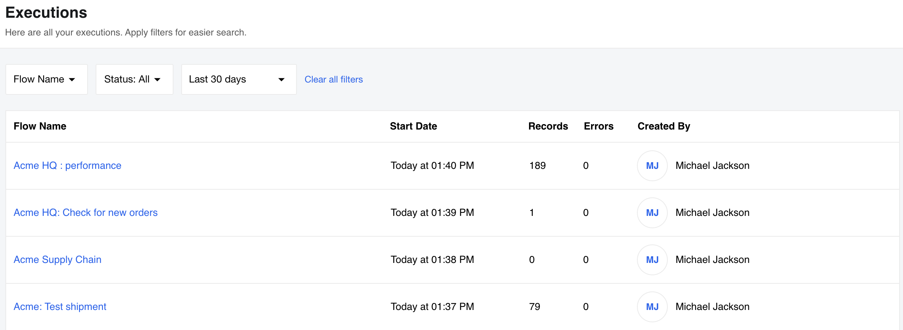
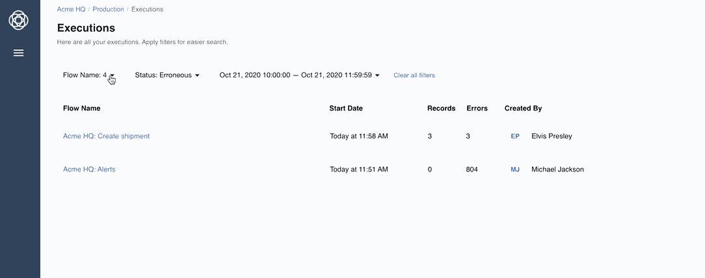
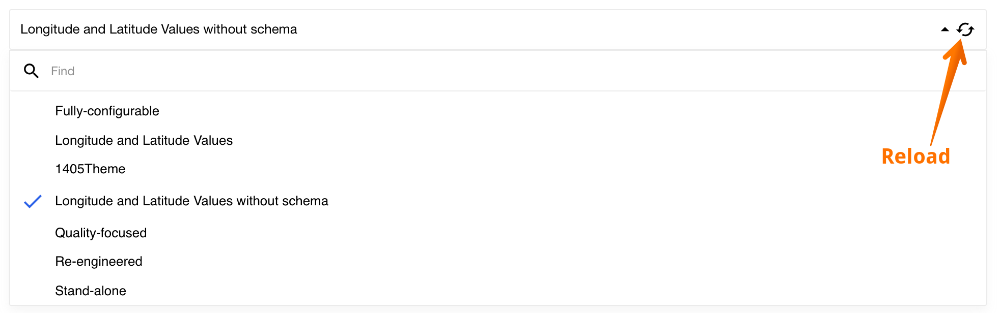
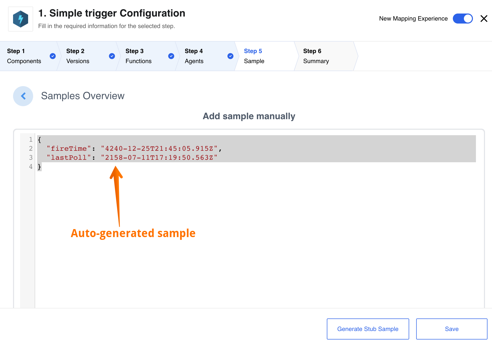
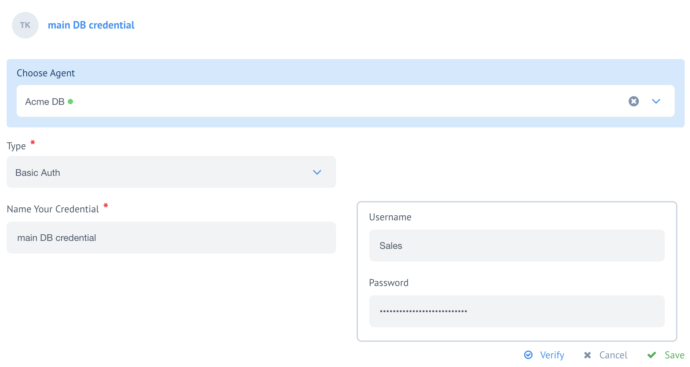
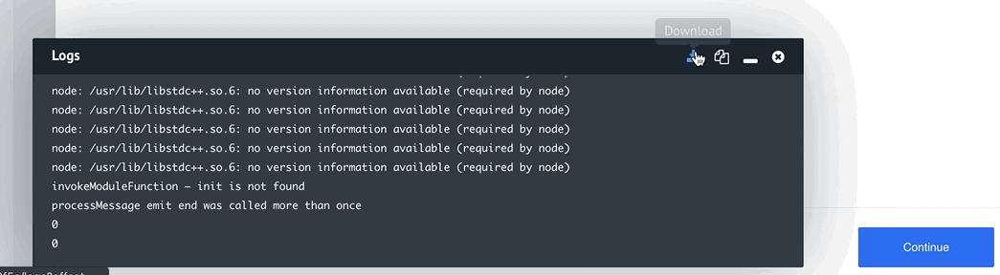

## Product update - v20.43

**Released: 2020-10-26**

*   [Features](#features-v2043)
*   [Improvements and Updates](#improvements-and-updates-v2043)
*   [Fixed Bugs](#fixed-bugs-v2043)
*   [Components](#components-v2043)

### Features (v20.43)

#### Secrets Feature (v20.43)

We are happy to announce the public release of Secrets feature - a service which independently
keeps access tokens up-to-date so any integration step would get a valid and working
access credentials to the third party resources. The service updates tokens behind the
scene using the token expiration information.

Secrets addresses the race-condition and other contention-on-shared-data problems
of OAuth2 authorisation process frequently happening due to concurrent and asynchronous
work of steps in different integration flows. With this service in place, components
are not required to update the access tokens. The Secrets takes over this process
and supplies the Components up-to-date access tokens directly.

For more details visit the dedicated [Secrets feature](/getting-started/secrets)
documentation page.

#### New components working with Secrets (v20.43)

Along with the public release of Secrets we are releasing two new generation
components, **REST API v2** and **Salesforce v2**, which use the Secrets Management Service.

These fully refurbished components are not strictly backwards compatible due to
architectural differences between Secrets and the ordinary Credentials systems.

The old versions of these components are still available for a foreseeable future,
however, they will be marked as deprecated. We will only make security updates if
required, but further development of these versions will not be done.

**We encourage our customers to try the new generation components and give us your feedback.**

#### Visibility Authentication Clients (v20.43)

With this release we completed the authentication clients (`auth-client`)
visibility levels. The `auth-client` can now have `workspace`, `contract`, `tenant`
and `global` access levels. This means you can create `auth-client` for any access
level, be that only for one workspace or for the entire cluster of tenants.

Check our [API documentation]({{site.data.tenant.apiDocsUri}}/v2#/auth%20clients/post_auth_clients)
for more information on `auth-client` creation.

### Improvements and Updates (v20.43)

#### Execution and Logs pages (v20.43)

From this release, all execution threads on Executions page will show the times
in absolute format AM/PM or 24h depending on your local setup.



We are introducing **Clear all filters** enhancement for Executions and Logs pages
for clearing all selected filters in one go. Here is an example of usage on Logs
page:



> This feature is hidden by CSS by default so that the look & feel of OEM tenants
> is not disrupted. Feel free to adjust the CSS to introduce this functionality in your tenant.

#### Mapper UI (v20.43)

We continue our efforts to streamline and improve the new mapping experience
based on your feedback. In this release we concentrated on loading time
improvements, JSONata previews, dynamic drop-downs and manual sample creation.

When using JSONata expression for input fields, the preview is rendered with
"pretty print" instead of one single line of code which ehances the mapping
experience and helps to spot any errors while building an integration flows.

When using the dynamic drop-downs fields the search appears only if there are
more than 7 items to choose. In addition, all dynamic drop-downs have reload buttons
to refresh the list.



While designing an integration flow you can just use an automatic sample regenerated
the platform and already populated based on the metadata.




#### Authentication Secrets with Agents (v20.43)

Now you can choose to add Authentication credentials for the steps running on
Local Agents. It works for old and new VPN Agents.



#### Node.js Sailor update to 2.6.17 (v20.43)

We release a latest update of Node.js Sailor version `2.6.17` which disables
message header logging at `info` level.

### Fixed Bugs (v20.43)

*   Addresses the issue with Rendering Large Amount of Input Fields in the Browser.
*   Fixes the bug when unexpected and out of order execution results appear in thread list.
*   Addresses the UI bug when the Logs window in the flow-designer overlays the Continue button.
*   Fixes the restriction of Recipe activation with Secrets.
*   Addresses the UI bug when an invalid JSONata expression in the new mapper would not case error.
*   Fixes the problem with passing the value to text-field-view.
*   Addresses the problem when the dynamic metadata generation while toggling between actions that have dynamic metadata but no configuration fields.

### Components (v20.43)

#### [Salesforce Component](/components/salesforce/) (v20.43)

A new version 2 component is introduced. While technically it is similar to the
old one, this component uses the new service to manage Secrets. We have also removed
the deprecated functions from the new Salesforce v2.

*   **NEW** - Component uses Secrets Management Service for OAuth.
*   **NEW** - Component uses the latest (`v2.6.17`) Node.js Sailor.

#### [REST API Component](/components/rest-api/) (v20.43)

A new version 2 component is introduced. While technically it is similar to the
old one, this component uses the new service to manage Secrets.

*   **NEW** - Component uses Secrets Management Service for OAuth.
*   **NEW** - Component now includes attachment information in outbound message.
*   **NEW** - Includes status code, HTTP headers along with body in produced message.
*   **IMPROVEMENT** - Annual audit of the component code to check if it exposes a sensitive data in the logs.

#### [Oracle EBS Component](/components/oracle-ebs/) (v20.43)

Introducing a new component for working with the Oracle E-Business Suite services.

*  **NEW** - Introducing new `Execute Method` action.

#### [Microsoft Dynamics CRM Component](/components/msdynamics-crm/) (v20.43)

*   **FIXED** - `emit` called without `await` cases in the code.
*   **UPDATED** - dependencies for all used packages.
*   **IMPROVEMENT** - Annual audit of the component code to check if it exposes a sensitive data in the logs.

#### [SugarCRM Component](/components/sugarcrm/) (v20.43)

*   **IMPROVEMENT** - Annual audit of the component code to check if it exposes a sensitive data in the logs.
*   **UPDATED** - dependencies for all used packages.

#### Sailor version update in bulk (v20.43)

Following the Node.js Sailor version `2.6.17` release, we updated the following
integration components dependencies:

*   [Code Component](/components/code/)
*   [Lookup Table Component](/components/lookup-table/)
*   [Email Component](/components/email/)
*   [Google BigQuery Component](/components/google-bigquery/)
*   [Jsonata Component](/components/jsonata/)
*   [Mapper Component](/components/mapper/)
*   [Pub-Sub Component](/components/pub-sub/)
*   [Request-reply Component](/components/request-reply/)
*   [REST API Component](/components/rest-api/) - both deprecated and new V2
*   [Router Component](/components/router/)
*   [Simple-trigger Component](/components/simple-trigger/)
*   [Splitter Component](/components/splitter/)
*   [Utility Component](/components/utility/)
*   [WebHook Component](/components/webhook/)
*   [MongoDB Component](/components/mongodb/)

## Product update - v20.47

**Released: 2020-11-19**

*   [Features](#features-v2047)
*   [Improvements and Updates](#improvements-and-updates-v2047)
*   [OEM Related](#oem-related-v2047)
*   [Fixed Bugs](#fixed-bugs-v2047)
*   [Components](#components-v2047)

### Features (v20.47)

#### Debug and one-time execution logs (v20.47)

We introduce a new possibility to obtain the debug and one-time executions logs
straight from the logs window. You can choose to **Download** the logs directly to your
computer and the system will give you a time-stamped `*.log` file or you can choose
**Copy to clipboard** to paste the logs where you need. The small animation below shows
these options.



### Improvements and Updates (v20.47)

With this release we spent considerable time to streamline and improve the platform
UI pages. For example **the executions page is now more responsive and the new executions show much faster than before**.
By our initial estimate it loads 20 to 30% faster. We also load next and previous
executions pages asynchronously to improve the first page loading speed.

The mapper UI received a particular attention where we improved the
usability of multiple features explained in the following subsections.

#### Empty dynamic-select model (v20.47)

While using the dynamically selectable fields from third party sources you might
encounter situations when no metadata is returned. In this cases we will show the
following warning text to text:

> Unfortunately the service behind the component did not provide any options for the given credentials. This is not necessarily an error. Please check whether there are data for the given credential and retrieve the options again by clicking on the Reload icon on the right side of the drop-down element.

#### Re-sizable text-input fields (v20.47)

All text-input fields now grow with the content. When the you have an input longer than
4 to 5 lines, a new vertical resize selector in the right bottom corner of the
field appears. You can use it to extend the field for your viewing convenience.

#### Scrolling of mapped fields (v20.47)

You can scroll to see all the content of mapped fields in any saved flow versions.
The scroll-bars show not only the input fields but besides the mapping results too.

#### Object types in mapping fields (v20.47)

You can now switch between Integrator and Developer modes and edit without a problem
while using any `object` type in your mapping.

#### Node.js and Java Sailor updates (v20.47)

We are constantly improving Sailor versions for Node.js and Java programming
languages. In this round we addressed edge cases when trigger and action functions
might output sensitive data while processing error stacks. Here are the most recent
versions:

*  Node.js Sailor version `2.6.18`
*  Java Sailor version `3.3.1`

#### Auth-clients without expiration (v20.47)

To address certain 3rd party OAuth2 provider unique setups we introduced default
`token_expires_in` parameter with 1 hour interval. The background of the problem
came from the cases when the external systems (e.g. Salesforce) would not return
`token_expires_in` for the `auth-client` calls.

Now any authentication client without `expieres_in` parameter receives a default
`token_expires_in` parameter with 1 hour value. This value will propagate to the
connected secrets as well. The API documentation was updated accordingly.



### OEM Related (v20.47)

#### Configure timeouts for debug tasks (v20.47)

You can now configure how long it would take the debug tasks to timeout
and severe the connection with the third party resource. We introduced a new variable
`FORCE_DESTROY_DEBUG_TASK_TIMEOUT_SEC` which can be defined in platform deployment
`config.json` file to control this behaviour. If this parameter is not defined the
default behaviour is the following:

*   Frontend timeout after 60 seconds.
*   Back-end timeout in 180 seconds.

#### Removing default favicon for tenants (v20.47)

If the favicon is not defined for your tenant the platform will return 404 on
`/favicon.ico` address. Please make sure to define it as a tenant parameter for your
tenant. To define the favicon you would need to define the parameter `favicon_url`
as it is explained in the [API documentation]({{site.data.tenant.apiDocsUri}}/v2#/tenants/patch_tenants__tenant_id_).
Contact support if you require need help in setting this up.

#### Recipes permissions per tenant (v20.47)

As an OEM manager you can control which role holder can create recipes from the
flows. We introduced a new permission `workspaces.flow.exportToRecipe` which you
can grant to `Admin`, `Integrator` or any newly created role to manage recipe creation.

> **Please Note:** The workspace `Owner` role can not receive this permission since the
> role is restricted and any changes to the role is against the security policies
> defined by the law. You can, however, add an additional role to the workspace
> `Owner` which has the permission to create recipes.

In addition, the Tenant Administrator role can export a flow to a recipe if he/she
has access to the flow. These changes are also applied in the
[API documentation]({{site.data.tenant.apiDocsUri}}/v2#/recipes/post_flows__flow_id__export_to_recipe).

To benefit from these changes a migration process must be done which is handled
by the gendry.

#### New permissions added (v20.47)

We introduce new sets of permissions including `/v2/permissions` and all error
messages to extend the existing sets to `global` access for multi-tenant
installation of the platform. The following permission were replaced with their
global counterparts:

`contracts.auth_clients.create`, `contracts.auth_clients.delete`, `contracts.auth_clients.edit`,
`contracts.auth_clients.get`, `workspaces.auth_clients.create`, `workspaces.auth_clients.delete`,
`workspaces.auth_clients.edit`, `workspaces.auth_clients.get`, `tenants.auth_clients.get`,
`tenants.auth_clients.edit`, `tenants.auth_clients.create` and  `tenants.auth_clients.delete`.

Replacements:

`global.auth_clients.get`, `global.auth_clients.edit`, `global.auth_clients.create` and `global.auth_clients.delete`.




### Fixed Bugs (v20.47)

*   **Fixed the bug when the mapped data would disappear after component version change.**
*   Addresses issue when a JSONata expression would disappear from the mapped fields.
*   Fixed the issue when the system would not save dynamic-select model in cache.
*   Fixed the problem when select-model stops executing while opening the log window in the flow-designer.
*   Addressed the behaviour when data from previous steps would disappear after some manipulations.
*   Fixed the inconsistency when duplicate logs were shown during the flow-designer.
*   Addressed the "Allowed Values" limitation of the new mapping experience to handle large number of values.
*   Fixed the bug in case of REST API component when the user entries would disappear.
*   Addressed the problem when the metadata would disappear in case of identical value entry in the drop-down list (select model).
*   Fixed a strange behaviour in the new mapping experience with changed select-model lists.
*   Addressed the problem with Splitter component when component would constantly "blink" between configured and non-configured modes during flow design.
*   Fixed the problem when the Browser window would crash during editing a flow with large number of steps.

### Components (v20.47)

#### [Batch Component](/components/batch/) (v20.47)

*   **FIXED** - Credentials verify minor issue.
*   **FIXED** - MongoError: `Authentication failed by authSource`.
*   **IMPROVEMENT** - Annual audit of the component code to check if it exposes a sensitive data in the logs.
*   **UPDATED** - Dependencies and the Node.js Sailor version to `2.6.18`.
*   **UPDATED** - `batching-library` version.

#### [Google Spreadsheets](/components/gspreadsheet/) (v20.47)

*   **IMPROVEMENT** - Annual audit of the component code to check if it exposes a sensitive data in the logs.
*   **UPDATED** - Dependencies and the Node.js Sailor version to `2.6.18`.
*   **UPDATED** - Removed the deprecated functions.

#### [REST API Component](/components/rest-api/) (v20.47)

*   **IMPROVEMENT** - Automatically retry 5 times on network failure.
*   **IMPROVEMENT** - All network failures trigger rebounds in case of **enable rebound** option set.
*   **UPDATED** - Dependencies and the Node.js Sailor version to `2.6.18`.
*   **UPDATED** - The deprecated V1 component icon to gray-scale.

#### [Salesforce Component](/components/salesforce/) (v20.47)

*   **FIXED** - Field dependencies from object field in `component.json` which caused en error in drop-down.
*   **UPDATED** - Dependencies and the Node.js Sailor version to `2.6.18`.
*   **UPDATED** - The deprecated V1 component icon to gray-scale.

#### [SugarCRM Component](/components/sugarcrm/) (v20.47)

*   **FIXED** - an exception when `emit`was called without `await`.
*   **FIXED** - an issue when Verify credentials button would not verify credentials.
*   **IMPROVEMENT** - Annual audit of the component code to check if it exposes a sensitive data in the logs.
*   **UPDATED** - Dependencies and the Node.js Sailor version to `2.6.18`.

#### Sailor version update in bulk (v20.47)

As a part of the annual component code audit for a possibility of sensitive data
exposing we checked and updated the following component codes and the dependencies:

*   [Allmysms Component](/components/allmysms/)
*   [AppDirect Component](/components/appdirect/)
*   [Amazon MWS Component](/components/amazon-mws/) - Java Sailor `3.3.1`.
*   [AWS S3 Component](/components/aws-s3/)
*   [AWS SNS Component](/components/aws-sns/)
*   [Code Component](/components/code/)
*   [Configuration Component](/components/configuration/)
*   [CSV Component](/components/csv/)
*   [Dropbox Component](/components/dropbox/)
*   [Email Component](/components/email/)
*   [Google BigQuery Component](/components/google-bigquery/)
*   [Jsonata Component](/components/jsonata/)
*   [Lookup Table Component](/components/lookup-table/)
*   [MailChimp Component](/components/mailchimp/)
*   [Mapper Component](/components/mapper/)
*   [Marketo Component](/components/marketo/)
*   [Microsoft OneDrive component](/components/onedrive/)
*   [MongoDB Component](/components/mongodb/)
*   [OData Component](/components/odata/)
*   [Pub-Sub Component](/components/pub-sub/)
*   [Quickbooks Component](/components/quickbooks/)
*   [Request-reply Component](/components/request-reply/)
*   [Router Component](/components/router/)
*   [SFTP Component](/components/sftp/)
*   [Shopify Admin Component](/components/shopify-admin/)
*   [Simple Storage Component](/components/key-value/)
*   [Simple-trigger Component](/components/simple-trigger/)
*   [Splitter Component](/components/splitter/)
*   [Utility Component](/components/utility/)
*   [WebHook Component](/components/webhook/)
*   [XML Component](/components/xml/)
*   [ZIP Component](/components/zip/)
*   [Zoho Component](/components/zoho/)

## Product update - v20.51

**Released: 2020-12-17**

*   [Features](#features-v2051)
*   [Improvements and Updates](#improvements-and-updates-v2051)
*   [OEM Related](#oem-related-v2051)
*   [Fixed Bugs](#fixed-bugs-v2051)
*   [Components](#components-v2051)

### Features (v20.51)

#### Feature fields in developer mode (v20.51)

With this release we introduce feature fields for the mapper Developer mode. You
can open and examine the component input metadata and add needed objects by clicking
on it. You can also add the path to property if using function or expression.

{% include img.html max-width="100%" url="/assets/img/RN/2051/feature-fields-developer-mode.gif" title="Developer mode feature fields" %}

Animation above shows an example of these fields while configuring the email component.

#### Flow step logging level setup (v20.51)

As an integrator or component developer we need to dive into the troubleshooting
and debugging sessions to identify and iron out some problems in our projects.
For this purposes, the detailed logs are invaluable. On the other hand, detailed
logs are sometimes unnecessary during the normal operation runs if you tend to
exchange sensitive data through your integration projects.

To control the logging level for each of your flow-step we introduce a new
setup called **Log Level**, accessible from the Advanced Setting part of flow-step
Summary. With this setup you can increase or decrease the output logging level of
your component from the default **Info** using the drop-down control shown below.

{% include img.html max-width="100%" url="/assets/img/RN/2051/log-level-setup.png" title="Choose the logging level" %}

> **Please Note:** To change the logging level of any flow-step, you must create
> a new draft for your flow, save it and start again.

The available logging levels are **Trace**, **Debug**, **Info**, **Warning** and
**Error** where the **Trace** will output everything your component can show. On the
other end of this spectrum, the **Error** level would output only the flow-step errors.

You can set or change the logging level directly using our REST API call. For this
purposes we extended the flow step configuration by adding the `log_level` parameter:

```json
"attributes": {
  "nodes_config": {
    "step_1": {
      "log_level":"info"
    }
  }
}
```

> **Please Note**: You can only change the logging level for run-time executions.
> This setup would not work on one-time executions like retrieve sample and verify credentials.

#### Retry-all flow errors (v20.51)

During some exceptional circumstances, you might get too many errors in your flow
execution step to [retry it one-by-one](/developers/error-retry#reprocess-and-retry). To help
process these errors in one go we introduce a new option **Retry All Errors** which
will appear if more than one error happens in this step during an execution.

{% include img.html max-width="100%" url="/assets/img/RN/2051/retry-all-errors.png" title="Retry all button" %}

When clicked, our system will ask you to confirm your action by displaying you
the following popup message:

> Note: the error messages will be deleted from this Runlog Record. Retry results will arrive to this Runlog record.

{% include img.html max-width="60%" url="/assets/img/RN/2051/retry-all-errors-confirmation.png" title="Retry all confirmation" %}

You can cancel and return to your screen with errors or confirm and retry all
errors, in which case our system will retry all retriable errors. This feature
has a limitation: **you can't edit messages before retrying while using retry all errors**.

> **Please Note**: Only messages in the single step of particular executions will be retried. It is
> not possible to retry errors from all steps or from all executions of the flow. For that you still
> need to open each step in particular execution separately and press retry all button.

### Improvements and Updates (v20.51)

#### Old mapping experience end-of-life (v20.51)

With this final release of the year 2020 we announce the end-of-life for our old
mapping experience which was with us for several years and served us well.

From this release the new mapping experience will be the default and it is no longer
possible to switch-back and forward between them.

> Please Note: If you still need to use the old mapping experience and you are
> one of the OEM customers get in touch with us - we can enable it for your tenant.

#### Node.js Sailor updates (v20.51)

With this release we introduce next sets of improvements to the Node.js Sailor,
the base library used to compile any Node.js based component code during the
platform deployments.

> **Component Developers Note**: Use Sailor version `2.6.21` along with the Node
> version `12.20.0` or higher for these improvements. Details follow.

##### AMQP connection problems (v20.51)

Starting from the Node.js Sailor version `2.6.19+`, we improved the mechanism used
in the connection to and from the RabbitMQ queues and the pods running your component
code.

*   Introducing a separate connections for consuming and publishing the messages.
*   The consuming is done with polling instead of pushing.
*   The re-connects on connection errors.
*   It handles the consumer cancel notifications.
*   Decreased the logging levels for certain cases to help troubleshoot problems.
*   We introduce new environment variables you can use in your components to control connection to and from queues engine:
    *   `AMQP_RECONNECT_ATTEMPTS` - number of retries on connection close.
    *   `AMQP_RECONNECT_TIMEOUT` - delay between connection retries.
    *   `WAIT_MESSAGES_TIMEOUT` - delay between next poll when queue is empty.

##### Rebound Headers (v20.51)

Starting from the Node.js Sailor `2.6.21+`, the rebound message headers and the rebound
message expiry time inconsistencies are fixed.




### OEM Related (v20.51)

#### Configure timeouts for one-time executions (v20.51)

You can now configure how long it would take the one-time execution to timeout
and severe the connection with the third party resource. We introduced a new
variable `FORCE_DESTROY_ONE_TIME_EXEC_SEC` to control the timeout.

To use this functionality add/change `force_destroy_one_time_exec_sec` ksonnet
parameter in the `config.json` file and write your desired time.
**The default is 120 seconds.**

#### Enabling old mapping experience (v20.51)

We introduced tenant setup parameter flag `tenant.feature_flags.old_mapper_enabled`
to control visibility of the switcher between old/new mapper. With this release
the flag is set to `false` by default.

As an OEM customer you can still enable and use the old mapping experience.
Use the tenant setup parameter flag `tenant.feature_flags.old_mapper_enabled` with `true`
value. Check our API documentation for `/v2/tenants` endpoint parameter flags.



### Fixed Bugs (v20.51)

*   Addressed the problems with deleting symbols in the text-fields for OAuth2 credentials.
*   Fixed the manual sample creation UX.
*   Fixed the missing scrolling in the developer mode for components with metadata exceeding the visible area of the browser window at the bottom edge.
*   Addressed the problem of lost focus during the new-credential creation after pressing the button "Add New Credential".
*   Addressed the case with the null result of the component select-model. Now it shows the error. Please reload the select model.
*   Fixed the problem when the configuration field were missing in the recipe activation screen for the steps which use secrets.


### Components (v20.51)


#### [Batch Component](/components/batch) (v20.51)

*   **FIXED** connection bug preventing authentication with the MongoDB.

#### [Filter Component](/components/filter/) (v20.51)

*   **FIXED** bug when the produced body had an excessive meta structure containing the actual meta information of all processing steps. Now the produced body is exactly the same as sample produced by the REST API component.

#### [PostgreSQL Component](/components/postgresql/) (v20.51)

*   **FIXED** the problem when the component could not connect PostgreSQL databases hosted on Heroku.

#### [Salesforce Component](/components/salesforce/) (v20.51)

*   **FIXED** the bug when the `Lookup by field` configuration field depended on `Object` field in the component action.

#### [Utility Component](/components/utility/) (v20.51)

*   **IMPROVED** the attachment to string functionality. Now you can use either the attachment ID or the URL.
*   **IMPROVED** the string to attachment functionality. Now the component recognises the URL and the size. Both of them are written to the message body.

#### [REST-API Component](/components/rest-api/) (v20.51)

*   **IMPROVED** the functionality of component to encounter for network failures. Now the component will start automatic retries in cases of errors like `ETIMEDOUT`, `ECONNRESET` etc.
*   **UPDATED** - Dependencies and the Node.js Sailor version to `2.6.21`.

#### [Appdirect Component](/components/appdirect/) (v20.51)

*   **UPDATED** - Dependencies and the Node.js Sailor version to `2.6.19`
*   **NEW** action `Finalize Opportunity` is added.
*   **NEW** action `Request Opportunity Review` is added.
*   **NEW** object types were added to the `Create Objects` action. In particular `Opportunity`. `Opportunity Item` and `Lead.`
*   **NEW** object types were added to `Update Object` action: `Opportunity`, `Opportunity Item`, `Company` amd `Lead`.
*   **UPDATED** the following metadata for the `Update Object` (Company object type) and `Lookup Objects` (Company object type).


#### Sailor version update in bulk (v20.51)

As a part of the annual component code audit for a possibility of sensitive data
exposing we checked and updated the following component codes and the dependencies:

*   [Amazon AWS Lambda](/components/aws-lambda/)
*   [BazaarVoice Component](/components/bazaarvoice/)
*   [Channeladvisor Component](/components/channeladvisor/)
*   [Dun & Bradstreet Component](/components/dun-and-bradstreet/)
*   [Edifact Parser Component](/components/edifact-parser/)
*   [Google translate Component](/components/google-translate/)
*   [Keenio Component](/components/keenio/)
*   [LDAP Component](/components/ldap/)
*   [Lightspeed Ecom Component](/components/lightspeed-ecom/)
*   [Lightspeed Retail Component](/components/lightspeed-retail/)
*   [Lionbridge-translate Component](/components/lionbridge-translation/)
*   [Mapper Component](/components/mapper/)
*   [Microsoft Dynamics CRM Component](/components/msdynamics-crm/)
*   [Microsoft Dynamics NAV Component](/components/microsoft-dynamics-nav/)
*   [Netsuite Component](/components/netsuite/)
*   [Outlook Component](/components/outlook/)
*   [PipeDrive Component](/components/pipedrive/)
*   [SDL-translate Component](/components/sdl-translate/)
