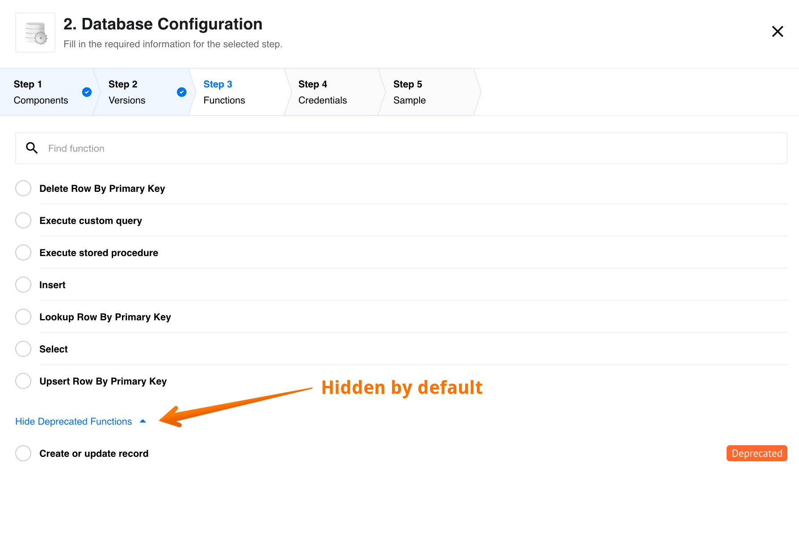
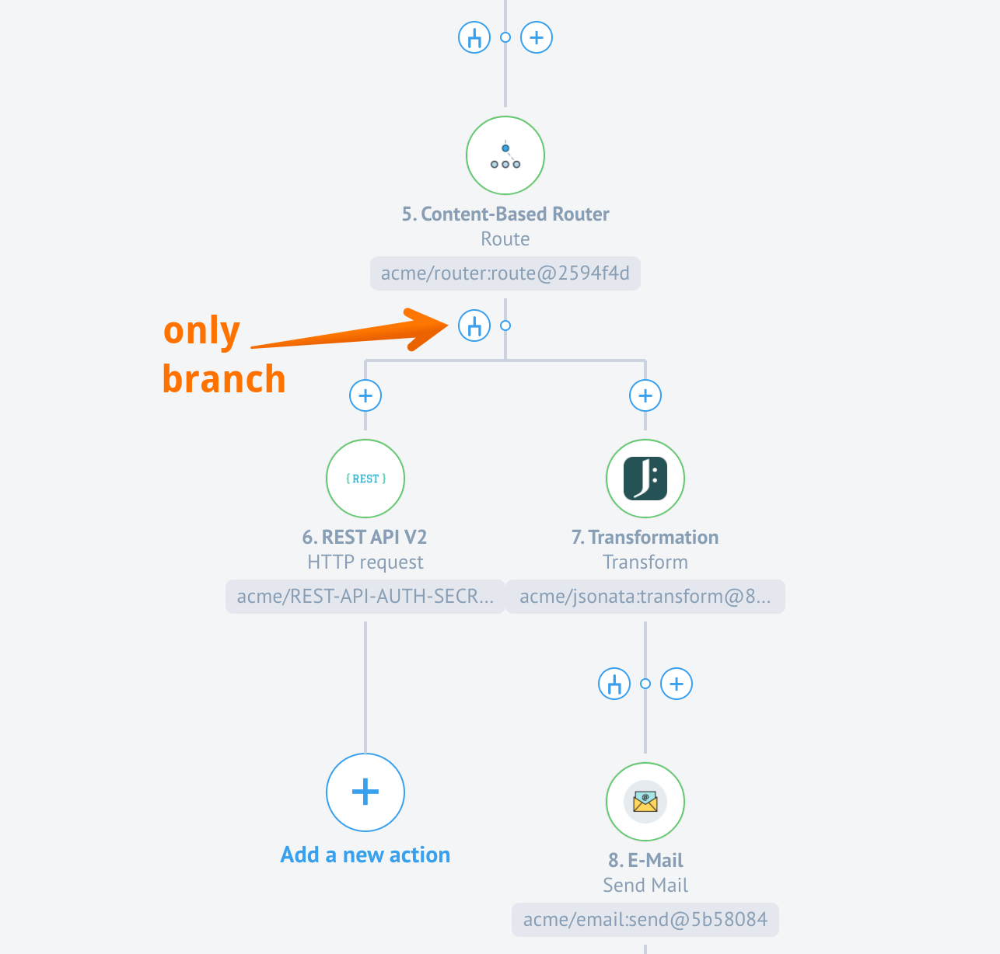

## Product update - v21.02

**Released: 2021-01-14**

*   [Features](#features-v2102)
*   [Improvements and Updates](#improvements-and-updates-v2102)
*   [Fixed Bugs](#fixed-bugs-v2102)
*   [Components](#components-v2102)

### Features (v21.02)

#### Hidden component deprecated functions (v21.02)

To streamline the user experience while building integration flows, we introduce a separation
between component active and deprecated functions. From now on all
deprecated functions will be listed under **Deprecated Functions**
menu which will be hidden/closed by default. Here is an example of Functions tab
in Database component where the **Deprecated Functions** menu is open:

We have also improved the look and feel of the radio selectors in general.

### Improvements and Updates (v21.02)

In this release we continued to streamline and improve the platform
UI pages. For example viewing and editing JSON objects while in integrator mode
is now more comfortable.

#### verifyCredentials errors (v21.02)

We improve the rendering of errors while component credential verification fails. If the
component code reports an error, this will be shown in the credential UI as it is.

#### Node.js Sailor updates (v21.02)

With this release we continue improvements of the Node.js Sailor, the base
library used to compile any Node.js based component code during the platform deployments.

Node.js Sailor version `2.6.22` is introduced to enable `keep-alive` for the global
HTTP agent. This release provides a remedy to limitation of outgoing HTTP connection
numbers often imposed by the cloud providers.

Node.js Sailor version `2.6.23` is introduced to prevent retry of the AMQP
connection errors in the system. It addresses such errors like
"Cannot read property 'publish' of undefined". In general, the AMQP connection
errors contain no data which can be used to put back into the message queues to retry.

### Fixed Bugs (v21.02)

*   Fixed the problem with unsaved credentials. It is now impossible to select the credential without saving it first. If you fill-in all the required fields and select the credential, then it will be saved.
*   Addressed the problem with the Configuration component credentials during the recipe activation phase.

### Components (v21.02)

#### [CSV Component](/components/csv/) (v21.02)

*   **FIXED** bug with Write From Array and multiple messages
*   **UPDATED** dependencies and the Sailor version

#### [Magento2 Component](/components/magento2/) (v21.02)

*   **FIXED** bugs in the **Create Order**
    *   No need to nest order entries in an item object
    *   Fix in metadata for order items
    *   Fix in metadata for regions & countries
*   **FIXED** bugs in the **Upsert Customer**
    *   Fix logic for regions & countries
    *   Countries can now be identified by two letter ISO code, three letter ISO code or by name.
    *   Regions can now be identified by ISO code or name.
    *   Respond to removed JSON schema reference hosted by Magento docs.
    *   Remove empty string from list of gender options.
*   **UPDATED** dependencies and the Sailor version

#### Sailor version update in bulk (v21.02)

As a part of the component code audit for a possibility of sensitive data
exposing we checked and updated the following component codes and the dependencies:

*   [Google PubSub Component](/components/google-pubsub/)
*   [MandrillApp Component](/components/mandrillapp/)
*   [Open-api Component](/components/open-api/)
*   [Petstore Nodejs Component](/components/petstore-nodejs/)
*   [twitter Component](/components/twitter/)
*   [SOAP Component](/components/soap/)

## Product update - v21.06

**Released: 2021-02-11**

*   [Features](#features-v2106)
*   [Statistics for Contract owners](#statistics-for-contract-owners-v2106)
*   [Notification: flows stopped in limited workspaces](#notification-flows-stopped-in-limited-workspaces-v2106)
*   [Improvements and Updates](#improvements-and-updates-v2106)
*   [OEM Related](#oem-related-v2106)
*   [Fixed Bugs](#fixed-bugs-v2106)
*   [Components](#components-v2106)

### Features (v21.06)

### Statistics for Contract owners (v21.06)

With this release we introduce a new API endpoint (`/stats`) for the contract
owners to collect statistical information including the number of workspaces,
flows and the component used in the flows.

Use the following call: **GET** `/v2/stats/workspaces?{contract_id}`, where the
`contract_id` is the ID of your contract. Your contract ID is the alphanumeric
number found in your browser address-bar after the letter `c/` and before `/w` while
you are logged-into the platform.

### Notification: flows stopped in limited workspaces (v21.06)

Our platform stops flows in the limited workspaces. We describe this in our
[Contracts and Workspaces](/getting-started/contracts-and-workspaces.html#limited-workspaces)
general article. With this release you will receive notification when the platform
stops them. You can still login and restart your flows.

### Improvements and Updates (v21.06)

#### Branch creation in Content Based Routers (v21.06)

With this release we improved the behaviour of the branch creation and modification
while working with the [Content Based Router](/components/router/) component. To avoid
confusion and standardise the experience the following changes were made:

*   You can not add a step after the Content Based Router and existing branches. The "plus" button is no longer available - only the branch or fork button is presented (see screenshot below).
*   When clicking on the fork button the branch creation menu opens where you can add more branches.

#### Node.js Sailor update (v21.06)

Current [Node.js Sailor version](https://github.com/elasticio/sailor-nodejs/blob/master/CHANGELOG.md) - `2.6.24`

With this release we introduce next sets of improvements to the Node.js Sailor,
the base library used to compile any Node.js based component code during the
platform deployments.

This particular update includes stability for large message (~50MB) processing through
the request-reply chain. If you intend to include your custom component in the
request-reply scenario, we highly recommend updating the Node.js Sailor to at
least `2.6.24` version.

Along with this new improvement the [Request-Reply](#request-reply-component)
(HTTP-Reply) component is updated. We recommend using at least 1GB RAM memory on
the HTTP-Reply component and at least 512MB RAM memory for each step in your
request-reply chain.

#### Java Sailor update (v21.06)

Current [Java Sailor version](https://github.com/elasticio/sailor-jvm/blob/master/CHANGELOG.md) - `3.3.2`

With this release we introduce next sets of improvements to the Java Sailor,
the base library used to compile any Java based component code during the
platform deployments.

With introduction of the the version `3.3.2` all errors in component
credential verification are shown in the UI as errors. Previously errors were shown
in the logs only.

#### Minor improvement to UI (v21.06)

With this release we standardised behaviour of the UI in the mapping fields. Some
notable improvements are:

*   In the Integrator mode you can used the Tab key for switching between fields and in the Developer mode - for formatting the JSON
structure.
*   The mapper in Developer Mode Reference now correctly renders the `enum` information.
*   It is now possible fill object into nested object field and array into nested array field so the value isn't converted to a string.
*   If you are member of more than 20 contracts or workspaces, you will not see them all on the left hand-side. Instead, a link with **load more** will appear which you can use to load more contracts.



### OEM Related (v21.06)

#### Bran Migration instructions (v21.06)

As a part of HA of our Clickhouse service, a migration of `Bran` service is required.
Here are the detailed [migration instructions](http://on-prem.elastic.io/installation/bran-migration.html)
necessary to go with the current release.

#### Notification about flows stopped in limited workspaces (v21.06)

We introduced a new notification to inform customers about flows being stopped in
the limited workspaces. As with every notification, this notification can be muted
by patching the tenant record. To mute add the `wiper-stop-limited-flow` in the list
of muted notifications in the tenant record. For more details [refer here](https://on-prem.elastic.io/white-label/platform-emails/templates).

#### Statistics for Tenant Administration (v21.06)

> **Note** you must have tenant Administrator role to benefit from this feature.

With the introduction of a new API endpoint `/stats`, the tenant Administration
can get the an extended statistical information about all the workspaces, flows and
the components used in the flows for the entire tenant.

Use the following call: **GET** `/v2/stats/workspaces`, to get the statistics. You
don't need to include the `contract_id` like in case of the contract unless you
need the statistics of one specific contract where you are the owner as well.

> **Please use this call with care.** This call can potentially be heavy for the
> DB if you have many customers in your tenant.

#### Tenant Administration Improvements (v21.06)

> Note: These changes are included in the 21.06.1 release

As a part of extending the capabilities of the tenant Administrator role we
implemented several changes greatly improving the capabilities of this role.

##### Access to contracts, workspaces and members (v21.06)

Tenant Administrator can list all the contracts in the tenant using the
**GET** `/v2/contracts` and **GET** `/v2/contracts/[:id]` API endpoints without
as if he/she was owner of the contract.

Tenant admin can see all the workspaces in any contract of the tenant using **GET** `/v2/contracts/[:id]`
API endpoint without being the member of this contract.

In addition tenant Administrator can get all workspaces and the members in these
workspaces using the **GET** `/v2/workspace/[:id]` API endpoint.

> **Note**: We have implemented paging on these endpoints for the UI. Every time
> only 20 records will be shown. You can use the link `load more` to see more records.

##### Access to the Developer teams (v21.06)

Tenant admin has now access to all developer teams in any contract using the
**GET** `/v2/teams[:/id]` API endpoint. A new permission `contract.devTeams.get` is added.

##### Access the Quota Data (v21.06)

Tenant Administrator can now retrieve quota data from any contract or workspace
in the the tenant via the **GET** `/v2/quota-usages/` and **GET** `/v2/quotas/:quota_type/:context_expression/`
API endpoints.

##### Modify members in Developer teams (v21.06)

Tenant Administrator has now access to **POST/PATCH/DELETE** `/v2/teams/{TEAM_ID}/relationships/members`
API endpoints as owner of the contract. With these right the tenant Administrator
modify (add or remove) members in the developer teams.

##### Modify members in Workspaces (v21.06)

Tenant Administrator has now access to **POST/PATCH/DELETE** `/v2/workspaces/{WORKSPACE_ID}/members`
API endpoint as owner of the contract. Which means, tenant Administrator can add
or remove members to any workspace in the tenant without being the member of the
contract or workspace. A new permission `tenant.workspace.edit_membership` is added to the platform.



### Fixed Bugs (v21.06)

*   Fixed the bug when the data for credentials verification were getting from cache instead of current UI state.
*   Addressed the problem when the code from latest component version executes during verify credentials instead of the code from chosen component version.
*   Fixed the UI bug when the REST API Headers field would write backwards if a hot key is used to jump between fields.
*   Addressed the problem with the scopes fields in the OAuth2 Credentials creation. These fields are not required.
*   Fixed a bug when some fields of published flow version were still possible to edit causing creation of a new draft version of the flow.
*   Address the problem when during the OAuth authentication process, error messages from the service provider as described in 4.1.2.1 were not displayed to the user.
*   Fixed the UI bug when the integration step configuration were blocked when the latest component version was selected.

### Components (v21.06)

#### [Request-reply component](/components/request-reply/) (v21.06)

*   **FIXED** a bug with memory leakage in Sailor
*   **UPDATED** the Sailor version: 2.6.24

#### [JDBC Component](/components/jdbc/) (v21.06)

*   **UPDATED** the Java Sailor version: 3.3.2

#### Sailor version update in bulk (v21.06)

As a part of the component code audit we updated the Node.js Sailor version to `2.6.24`
in the following components:

*   [Code Component](/components/code/)
*   [Configuration Component](/components/configuration/)
*   [Email Component](/components/email/)
*   [Google BigQuery Component](/components/google-bigquery/)
*   [Jsonata component](/components/jsonata/)
*   [Lookup Table Component](/components/lookup-table/)
*   [Mapper Component](/components/mapper/)
*   [MongoDB Component](/components/mongodb/)
*   [Pub-Sub Component](/components/pub-sub/)
*   [Request-reply Component](/components/request-reply/)
*   [REST API Component](/components/rest-api/)
*   [Router Component](/components/router/)
*   [Salesforce Component](/components/salesforce/)
*   [SFTP Component](/components/sftp/)
*   [Simple trigger Component](/components/splitter/)
*   [Splitter Component](/components/google-pubsub/)
*   [Utility](/components/utility/)
*   [Webhook Component](/components/webhook/)
*   [XML component](/components/xml/)

## Product update - v21.10

**Released: 2021-03-11**

*   [Improvements and Updates](#improvements-and-updates-v2110)
*   [OEM Related](#oem-related-v2110)
*   [Fixed Bugs](#fixed-bugs-v2110)
*   [Components](#components-v2110)

### Improvements and Updates (v21.10)

#### OAuth2 client creation in recipe activation (v21.10)

This release extends the functionality of the authentication client creation. Now
you can create OAuth2 authentication clients right from the recipe activation
page.

#### Loader for workspaces list in the invitation form (v21.10)

This specific improvement addresses the issue when the UI would not show more
than 20 workspaces in the invitation drop-down. Now loader would appear in case
you have more than 20 workspaces. Eventually the list of all workspaces would
be presented in the drop-down list.

> Please Note: only workspaces you have access to (permission `workspaces.workspace.edit`) will be loaded.

#### Configure dynamic flow control (v21.10)

If your component is written in Java then you can now disable the dynamic
flow control in the step by setting the `ELASTICIO_AMQP_PUBLISH_CONFIRM_ENABLED`
environment variable in the component repository as `false`. **This is only possible if your component is using the latest Java sailor version `3.3.5`.**



### OEM Related (v21.10)

#### SAML2 SSO Client (v21.10)

With this release we introduce initial support for SAML2 SSO Client. To support
multi-tenancy, each Tenant has to upload their own service provider configuration
for SAML 2.0 provider.

When a user clicks on the button in UI e.g. "Login with Facebook" a popup window
is opened with the target URL `/saml/authenticate?providerId={providerId}`. Backend
gets the provider from database by `providerId` for the requested tenant, constructs
service provider interface using `saml-js` library and redirects to the correct
auth URL(`assertEndpoint` or `/saml/callback?providerId={providerId}` if first
is not specified) of the SAML provider.

Then normal SAML 2.0 flow is taking place. In the end, the backend gets info
about the user and tries to find in its DB. If the user is not found, a user is
created on the fly (that is if `auto_create_user` is true in provider configuration)
using the given user data and temporary password, which could be changed later
on the profile page. After that, a new session is started and the user is being
redirected to the application itself.

If it is a new user then `first_name` and `last_name` will be taken from the
similar fields of the SAML 2.0 response attributes.

New frontend endpoints are introduced:
*   **GET** `/saml/authenticate?providerId={providerId}`
*   **POST** `/saml/callback?providerId={providerId}`

New DB tables:

*   `SAMLProvider`, more information form the [API-docs]({{site.data.tenant.apiDocsUri}}/v2#/tenants/post_tenants__tenant_id__saml_providers)
*   `SAML Identity`. This table is using to connect the user with the provider. The record has two relationships `user`
and `SamlProvider`. It has also an attribute called `is_new_user` that hold the record in case when the user was not registered in our system, before logging in using SAML 2.0. Service provider.

#### API-Docs URL setup (v21.10)

With this release we introduce new parameter `api_docs_url` to the tenant
configuration and a capability to manage and redirect visitors to the correct
API-documentation version. This is particularly useful in multi-tenant, white-labelled
environment where each tenant would have a unique api address.

To benefit from this new parameter you must set the `api_docs_url` parameter and
its value to the tenant record:

*   If `api_docs_url` is set in the tenant record, every link to the API documentation will be redirected to the provided address.
*   If your installation contains more than one tenants with the same `api_domain`, then `api_docs_url` property won't work correctly for any of these domains. Use `api_docs_url` only for tenants with unique `api_domain`.
*   If you set default `api_docs_url` (default is `https://[tenant.api_domain]/docs`) in `tenant.api_docs_url`, you will get a redirect loop.



### Fixed Bugs (v21.10)

*   Fixed the problem when the deleted content-based-router component step with not configured branches would block publishing of the draft.
*   Addressed the UI bug when the mapped data would disappear after reopening the flow to examine.
*   Fixed the error in copy flow when the dynamic `selectModel` was malformed due to 3rd party host issues.
*   Addressed the problem when no workspaces were shown while exporting the flow.
*   Fixed the UI bug when the header part would not load while opening the flow to view or edit.
*   Addressed the redirect loop problem of the api-docs service after the nginx ingress controller upgrade.

### Components (v21.10)

#### [Amazon MWS component](/components/amazon-mws/) (v21.10)

*   **FIXED** a bug when order status filtering didn't work and orders of all statuses were retrieved instead of a specified status.
*   **ADDED** a configuration field to set up a number of orders per one page.
*   **UPDATED** the Java Sailor version: `3.3.2`.

#### [CSV component](/components/csv/) (v21.10)

*   **ADDED** support for reading a file from a remote URL in Read CSV attachment action.
*   **UPDATED** the Node.js Sailor version: `2.6.24`.

#### [Magento2 component](/components/magento2/) (v21.10)

*   **FIXED** a bug in `Bulk Extract` trigger with incorrect trigger behavior with a large number of retrieved objects.

#### [NetSuite component](/components/netsuite/) (v21.10)

*   **ADDED** Token Based Authentication (TBA) option.
*   **UPDATED** the Java Sailor version: `3.3.2`.

#### [REST API v2 component](/components/rest-api/) (v21.10)

*   **FIXED** a bug with request Content-Type `mutlipart/form-data` header processing.
*   **FIXED** a bug when component fails when the server provides a binary response without Content-Length.

#### Sailor version update in bulk (v21.10)

As a part of the component code audit we updated the Node.js Sailor version to `2.6.24` in the following components:

*   [Edifact-parser component](/components/edifact-parser/)
*   [Filter component](/components/filter/)
*   [MsSQL component](/components/mssql/)
*   [PostgreSQL component](/components/postgresql/)
*   [ZIP/UnZIP component](/components/zip/)
*   [Dropbox component](/components/dropbox/)
