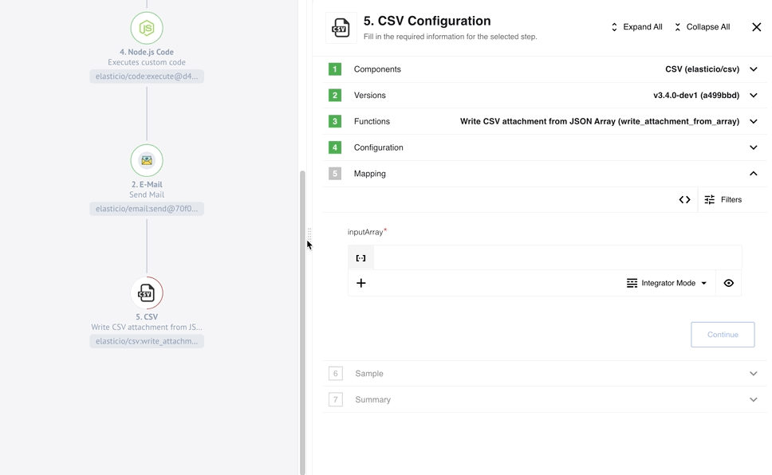
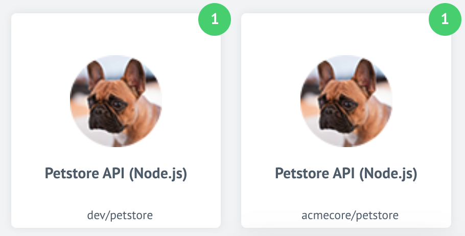

## Product update - v22.02

**Released: 2022-01-13**

*   [Improvements and Updates](#improvements-and-updates-v2202)
*   [Fixed Bugs](#fixed-bugs-v2202)
*   [Components](#components-v2202)

**Happy new year from our team!** Thank you for being with us. We appreciate your trust
in choosing our platform. Our team is working in full capacity to provide
new exciting features without forgetting to fix some outstanding problems along
the way to improve your user experience.

### Improvements and Updates (v22.02)

The release {{page.version}} includes lot's of work under the hood. Our team is
working to improve and refactor some of the core microservices.

#### Component deployments - path to new era (v22.02)

Our team is working towards more uniform component deployment mechanism. The one
which would work without involvement of our team. Many scenarios and mechanisms
are being considered. More details will come in our future releases.

With this release we have refactored an outdated code from the `gendry` service
to prevent component configuration change every time we deploy the platform code.

#### Component version check (v22.02)

When you deploy a new version of your component code our system builds it and
saves it in the docker registry. This process also checks the version of the
deployed code. If the version (or component semver) is the same or below the
deployed version the deployment fails. Previously, the semver check would happen
as a last step of the component deployment causing unnecessary delays for the
component developer and resource consumption on the platform side.

In {{page.version}} we change this behaviour. Now the platform would perform semver
check in the beginning and reject with the message **Error: Repo Build with version x.y.z already exists**
if necessary.

#### Logs page details improved (v22.02)

The three dots `...` for opening thread details in the end of the log string at
the Logs page now displays permanently instead of appearance on mouse hover.


### Fixed Bugs (v22.02)

*   Fixed the problem when external service unavailability would prevent rendering of the platform UI. Now the platform UI loading is unaffected by any exceptions or unavailability of the external services.
*   Fixed the UI bug when during the developer team or repository creation the mouse pointer would not be in the input field.
*   Addressed the bug when the validation error for JSON in the Topic page was given behind the text-area popup.

### Components (v22.02)

#### [Sugarcrm component](/components/sugarcrm/) `1.1.5` (v22.02)

*   **ADDED** the missing metadata

#### [Hubspot component](/components/hubspot/) `1.4.0` and `1.4.1` (v22.02)

*   **ADDED** support for File Custom Fields in `Upsert` action
*   **ADDED** option `Enable download attachments` to actions: `Lookup Objects`, `Lookup Object`, `Lookup Set of Objects`
*   **IMPROVED** the loading of component by reducing the icon file size
*   **FIXED** the bug with attachments uploading in the `Upsert` action

#### [Git-Protocol component](/components/git-protocol) `1.1.0`, `1.1.1` and `1.1.2` (v22.02)

*   **ADDED** a new action `Read from Branch`
*   **FIXED** a bug when metadata could not be loaded in the `Create Commit` action
*   **FIXED** a bug in verify credentials

#### [Docuware component](/components/docuware/) `1.0.0` and `1.1.0` (v22.02)

*   **ADDED** `Raw Request` action
*   **ADDED** `Lookup Documents (Lookup Objects Plural)` action
*   **ADDED** `Make Raw File Upload Request` action

#### [HJson component](/components/hjson/) `1.0.0` (v22.02)

*   **ADDED** `Convert` action

## Product update - v22.04

**Released: 2022-01-27**

*   [Features](#features-v2204)
*   [Improvements and Updates](#improvements-and-updates-v2204)
*   [OEM Related](#oem-related-v2204)
*   [Components](#components-v2204)

### Features (v22.04)

#### Announcement: New design for Step configuration (v22.04)

> We would like to inform you all about the impending roll-out
> of the new **Integration flow Step configuration page during our next 22.06 release**
> (10th of February 2022). Our OEM customers will receive the detailed explanation
> of changes in advance.

Here is the difference of already configured integration step showing the summary
page:

{% include img.html max-width="80%" url="/assets/img/RN/2204/eio-step-slide-overview.png" title="New Step Designer" %}

We would like to draw your attention to the impending changes:

1.  The upper panel showing the progress will change into a vertical sliding structure. You can expand each section vertically.
2.  Here you have information about already configured component like the component name, developer team, component version, used function and the ID of credential.
3.  Shows buttons you can use to expand or collapse all sections at once.

Next screenshot shows details of a component configuration view where not all sections
are completed:

{% include img.html max-width="60%" url="/assets/img/RN/2204/eio-step-slide-details1.png" title="Details of step configuration" %}

Here you can see the difference between already configured sections (shown in green),
next section to configure (filled grey) and the other sections (hollow grey) which
will not be possible to configure unless the previous section is completed.

Next screenshot shows details of a component configuration view where the Jsonata
field has an incorrect entry:

 {% include img.html max-width="60%" url="/assets/img/RN/2204/eio-step-slide-details2.png" title="Details of step configuration with error" %}

### Improvements and Updates (v22.04)

The release {{page.version}} includes lot's of work under the hood. Our team is
working to improve and refactor some of the core microservices.

#### Component deployments via Docker images (v22.04)

In our 22.02 release view announced our intention to find a new path for component
deployments. The one which would not require direct involvement of our support.

With this release we are happy to let you know that we have made significant progress
in identifying the reliable mechanism and testing our first node.js and Java component
deployments using the automated build processes from CircleCI.

Here is the workflow we have already in place:

1.  New version (`tag`) is created in the GitHub component repository and the release is published.
2.  CircleCI build process uses `appbuilder` + `apprunner` images.
3.  Docker image of the component is built with the `tag` version and submitted into the Dockerhub.
4.  An additional `latest` version is created at Dockerhub side each time code is updated.

Stay tuned for our next steps.



### OEM Related (v22.04)

News in this section are for our customers who use
[OEM version of the elastic.io platform](https://www.elastic.io/saas-embedded-integration/).

#### Quota for flow count (v22.04)

In the release [21.45 we announced](/releases/2021Q4) about the new quota feature capability to
limit flow counts per `workspace`, `contract` and `tenant`. To apply this quota
you must have either the **Service Account** or **Quota Manager** credentials.

*   If you host your own installation (on-premises case) then you already have these credentials.
*   If you have an OEM tenant on elastic.io hosted clusters talk to us for the quota management.

We have now a dedicated documentation page about the
[Flow Count Limit](https://on-prem.elastic.io/admin/quotas/flow-count-limit).




### Components (v22.04)

#### [Bigcommerce Component](/components/bigcommerce/) `1.0.0` and `1.1.0` (v22.04)

*   **ADDED** `Create` action
*   **ADDED** `Update` action
*   **ADDED** `Delete` action
*   **ADDED** `Lookup Object by ID` action
*   **ADDED** `Lookup Objects by multiple filters` action
*   **ADDED** `Make Raw Request` action

#### [Utility Component](/components/utility/) `1.4.0` (v22.04)

*   **ADDED** `Log Message` action
*   **ADDED** `Create JSON Patch` action
*   **ADDED** `Apply JSON Patch` action
*   **UPDATED** dependencies

## Product update - v22.06

**Released: 2022-02-10**

*   [Features](#features-v2206)
*   [Improvements and Updates](#improvements-and-updates-v2206)
*   [HELM3](#helm3-v2206)
*   [Components](#components-v2206)

### Features (v22.06)

#### Step configuration: new design (v22.06)

As we announced in the [22.04 release notes](/releases/2022Q1) we are introducing
new look and feel for the integration flow step designer.

{% include img.html max-width="100%" url="/assets/img/RN/2204/eio-step-slide-overview.png" title="New Step Designer" %}

The new step designer includes the following improvement and advancements to the
flow step configuration process:

*   You can view more than one section of the step configuration by opening the desired ones individually. You can expand and collapse all sections.
*   The new view shows more information about used component, like the version, used function and credential ID.
*   We enforce Continue buttons for configuration fields to make it clearer.
*   The passthrough on/off configuration now resides in the Advanced Settings of the Summary section.

### Improvements and Updates (v22.06)

The release {{page.version}} includes lot's of work under the hood. Our team is
working to improve and refactor some of the core microservices.

*   In case the platform detects simultaneous login sessions with the same account user will get notification email providing the details of new session.
*   We reduced your login session timeout time to 24 hours. This means in case of 24 hours inactivity you would need to login to continue using the platform user interface.

#### Old local agents removed (v22.06)

With the {{page.version}} we removed the old local agents from the platform. The
code is refactored. You can not request old local agents anymore.



### HELM3 (v22.06)

We constantly improve different aspects of HELM3 deployments in collaborations
with our partners. This section lists updates and improvements done in this round.

#### Special release process for on-prem (v22.06)

With the {{page.version}} platform version we refactored and removed part of the
platform code related the old Local Agents. For this reason a migration must be done.

> **Please note**, you must do the migration.

Follow these instructions for installation:

Make a DB backup before the release since the migration will remove the following data:

*   It will remove local agents from all credentials, secrets and integration flow steps. As the local agents are actually not used by our customers anymore, this should not affect you.
*   It will remove RabbitMQ Boatswain (local agent related) vhost, queues, policies and users (platform admin user will stay).


#### Platform Monitoring sections (v22.06)

For our on-prem customer we are sharing our own monitoring and alerting information
as an optional part of the HELM3 deployment. For details visit the
[dedicated monitoring](https://on-prem.elastic.io/admin/monitoring) page.

#### Changes to secrets (v22.06)

To reduce the login session timeout to 24 hours, you could set the `COOKIE_MAX_AGE`
variable to `86400000` (24 hours in milliseconds).

The following environment variables were removed:

*   `KUBERNETES_RABBITMQ_URI_SAILOR`
*   `RABBITMQ_URI_BOATSWAINS`
*   `MARATHON_URI`
*   `SECONDARY_MARATHON_URI`
*   `GELF_ADDRESS`
*   `CONTAINER_HTTP_PROXY`
*   `KUBERNETES_SLUGS_BASE_URL`
*   `USE_MAIN_MARATHON_ONLY`
*   `RABBITMQ_EXTEND_BOATSWAIN_ALL_QUEUES_POLICY`

For up-to-date HELM3 chart descriptions check the
[dedicated HELM3 deployments](https://on-prem.elastic.io/helm3) page.




### Components (v22.06)

#### [Bigcommerce Component](/components/bigcommerce/) `1.2.0` (v22.06)

*   **ADDED** `Create a Payment` action
*   **ADDED** `Orders` support for lookup (both) and delete actions
*   **ADDED** API versioning to `Make Raw Request` action


#### [Flow Linking Component](/components/flow-linking/) `1.0.0` (v22.06)

*   **ADDED** `Trigger another flow` action
*   **ADDED** `Receive trigger from another flow` trigger

#### [IPaas Core Component](/components/ipaas-core/) `1.3.0` (v22.06)

We release this component generally. These release notes include all updates
from version `1.0.0` to `1.3.0`

*   **ADDED** `Fetch Dynamic Select Model` action
*   **ADDED** `Fetch Dynamic Metadata` action
*   **ADDED** `Lookup Object (Plural)` action
*   **ADDED** `Raw HTTP Request` action
*   **ADDED** `Lookup Flow` action
*   **ADDED** `Upsert Flow` action

#### [REST API with Arbitrary Token Authentication component](/components/rest-api-token/) `1.0.0` (v22.06)

*   **ADDED** `HTTP request` action

## Product update - v22.08

**Released: 2022-02-28**

*   [Improvements and Updates](#improvements-and-updates-v2208)
*   [Fixed Bugs](#fixed-bugs-v2208)
*   [Components](#components-v2208)

### Improvements and Updates (v22.08)

#### Step designer: Summary page (v22.08)

After introduction of the new flow step designer with the last release, we continue
our efforts to improve the user experience. This week we present an improvement
to the summary page. Now you have the component version and used function listed
along the credential and component name.

{% include img.html max-width="60%" url="/assets/img/RN/2208/summary-page-impr.png" title="Summary page improvements" %}

#### Additional fields in OAuth2 type secret (v22.08)

You can now add additional fields along with the main OAuth2 type secret. To use
you must add additional fields into the `credentials` section of the `component.json`
together with the `oauth` field. For example:

```json
{
    "name": "Component Name",
    "authClientTypes": ["oauth2"],
    "credentials": {
        "fields": {
            "oauth": {
                "label": "Authentication",
                "viewClass": "OAuthFieldView",
                "required": true
            },
            "base_url": {
                "label": "Base URL",
                "viewClass": "TextView",
                "required": true
            }
        }
    }
}
```

This will render an additional field called `Base URL` along with other OAuth2
fields.

{% include img.html max-width="80%" url="/assets/img/RN/2208/auth-client-additional-field.png" title="Additional field rendered on UI" %}

You can also use the [API call]({{site.data.tenant.apiDocsUri}}/v2/#create-auth-secret)
to save the credential (auth-secret) with the additional fields.

> **Please Note** this additional field will only works with the `oauth` credential
> type containing the `OAuthFieldView` viewClass.

#### Hashing algorithm for storing credential (v22.08)

With {{page.version}} release the platform will start using `bcript`
(instead of `SHA-512`) to encrypt passwords before storing them into the DB. This
would mean:

*   The platform will use `bcript` to encrypt passwords of all new registered users.
*   Passwords for all existing users will be encrypted by `bcript` upon their next successful login or password change.
*   This transition is not backwards compatible. Meaning if the release is rolled-back you would need to reset your password to login.

### Fixed Bugs (v22.08)

*   Fixed the UI bug when an error message remains after the cancellation of invalid changes to topic.
*   Addressed a problem when the flow data was not refreshed after publishing a draft and returning to the Flows Page.
*   Fixed the problem when the platform would give an error in case when webhook-type component credentials would not have `auth` field defined. Now the field is ignored and credentials shown.


### Components (v22.08)

#### [Code component](/components/code/) `1.2.7` (v22.08)

**REVERTED** Node engine from `"node": ">=12.13.0"` to `"node": "12.20.0"`

#### [Vtex component](/components/) (v22.08)

*   **ADDED:**
  - Upsert Object Action
  - Lookup Objects (Plural) Action

#### [Bigcommerce component](/components/bigcommerce/) (v22.08)

*   **FIXED:** output metadata in some actions

#### [Mercado Pago component](/components/) (v22.08)

*   **ADDED:**
  - Get New and Updated Objects Trigger
  - Make Raw Request Action
  - Lookup Object (at Most 1) Action

#### [CSV component](/components/csv) (v22.08)

*   **ADDED** new Emit Behavior option: Emit Batch

## Product update - v22.10

**Released: 2022-03-10**

*   [Improvements and Updates](#improvements-and-updates-v2210)
*   [Fixed bugs](#fixed-bugs-v2210)

### Improvements and Updates (v22.10)

#### Step designer: Movable divider (v22.10)

The {{page.version}} platform release introduces further improvement to the step
designer. Now you can move or drag the horizontal divider between the step designer
and the general flow structure. This way you can adjust your working area according
to your preference.



#### Password change and user session (v22.10)

When you change or reset your password the system will invalidate all active sessions
associated with this user account.

> **Please Note** There can be an issue with active UI sessions. If you can't
> open UI pages, clear the browser cookies and try again.

#### Duplicate sign-in email (v22.10)

When the platform detects [duplicate sign-in session](/releases/2022Q1#improvements-and-updates-v2206)
for your account it sends an email notifying about it. In this release we improved
the text of this email for more clarity.

### Fixed bugs (v22.10)

*   Fixed the quota calculation mechanism on the UI to render more accurate values based on daily usage.

## Product update - v22.12

**Released: 2022-03-28**

*   [Features](#features-v2212)
*   [Improvements and Updates](#improvements-and-updates-v2212)
*   [HELM3](#helm3-v2212)
*   [Fixed bugs](#fixed-bugs-v2212)
*   [Components](#components-v2212)

### Features (v22.12)

#### Automated component deployments (v22.12)

In platform version {{page.version}} we are releasing the new automated
component deployment feature. We introduced the underlying concept with the version
[22.04](/releases/2022Q1#component-deployments-via-docker-images-v2204) release at
the end of January 2022. Here is the final workflow of the automated component
deployments:

1.  A new version (`tag`) is created in the GitHub component repository and the release is published.
2.  The CircleCI build process uses `appbuilder` + `apprunner` images.
3.  A Docker image of the component is built with the `tag` version and submitted to Dockerhub.
4.  An additional `latest` version is created in Dockerhub each time the code is updated.
5.  The platform runs a Kubernetes platform job called `components-pusher` at certain intervals checking the component Dockerhub `latest` version.
6.  If the version in Dockerhub differs from the existing platform version it pulls a new Docker image and pushes it into the platform docker registry.
7.  A new version of component is released for the platform users and can be selected while designing flows.

> **Please Note** - we determine and set the configuration of platform `components-pusher` in HELM3 deployment
> charts. These configurations provide more options for each component. Here we present the typical scenario.

The automated component deployment process works along with the old git-push
workflow. You can push components via git receiver as well. The `components-pusher` will not
interfere with your pushed version.

### Improvements and Updates (v22.12)

#### Node.js Sailor version `2.6.27` (v22.12)

We released a new version (`2.6.27`) of the Node.js Sailor library version. This
version includes an `npm` audit to CI and updated dependencies.

#### UX Improvements: credentials page (v22.12)

To improve the user experience on the credentials page we added the component
team and repository name to which this credential belongs. This helps in
distinguishing between different deployments of components and in choosing the correct
component for credential modification.

 

The above images show two different repositories of the same component.
The new improvement shows the difference between these two components.



### HELM3 (v22.12)

We constantly improve different aspects of HELM3 deployments in collaboration
with our partners. This section lists updates and improvements done in this round.

#### Configure password length and rules (v22.12)

With platform version {{page.version}} we introduce a new configuration to set the
login password length and the requirements. The following variables have been
added to HELM3 charts:

*   `MIN_PASSWORD_LENGTH` - the user password must have at least this number of symbols,
*   `MIN_PASSWORD_RULES_MATCHES` - number of minimum different character groups (uppercase, lowercase, numbers, special symbols) should be matched

#### Session timeout configuration (v22.12)

To provide more granular control for session timeout and distinguish between `idle`
and `absolute` timeouts we introduce new configurations and deprecate the `COOKIE_MAX_AGE`
environment variable. The `idle` and `absolute` timeouts follow definitions described
in the [OWASP](https://cheatsheetseries.owasp.org/cheatsheets/Session_Management_Cheat_Sheet.html#automatic-session-expiration). We also introduce the HELM3 configuration variables to control values
for these new timeouts:

*   `SESSION_IDLE_TIMEOUT` - default: 24 hours - replaces `COOKIE_MAX_AGE`,
*   `SESSION_ABSOLUTE_TIMEOUT` - default: `2` times the `SESSION_IDLE_TIMEOUT`.



### Fixed bugs (v22.12)

*   Addressed the issue when the "Server error" message would show while navigating through the UI upon the session expiration.
*   Fixed the bug causing the system to erroneously send "New sign-in to your account" emails. The expired sessions were not deleted from the system.
*   Addressed the issue with the "Mapping" configuration field showing up in UI for the trigger functions on components.

### Components (v22.12)

With introduction of automated component pusher we change the standardise component
build procedures preparing them for `components-pusher` service. The following component
build configurations were changed:

*   [GraphQL component](/components/) `1.1.1`
*   [CSV component v3](/components/csv/) `3.1.1`
*   [JDBC component](/components/jdbc/) `2.5.1`
*   [SOAP component](/components/soap/) `1.2.8`
*   [Shopify Admin Component](/components/shopify/) `1.5.0`

#### GraphQL component `1.1.1` (v22.12)

*   **ADDED** `No Auth`, `Basic Auth` and `API Key Auth` authentication methods
*   **ADDED** a new action `Raw Request`
*   **ADDED** a new action `Configured Request`

#### [Shopify admin component](/components/shopify-admin/) `1.5.0` (v22.12)

*   **ADDED:** a new action `Update Inventory Level`
*   **FIXED** the output metadata for `Get New And Updated Objects Polling` trigger

#### PayPal component `1.0.0` (v22.12)

*   **ADDED:** a new action `Make Raw Request`

#### [Vtex component](/components/vtex/) `1.2.0` (v22.12)

*   **ADDED:** a new action `Lookup Set Of Objects By Unique Criteria`
