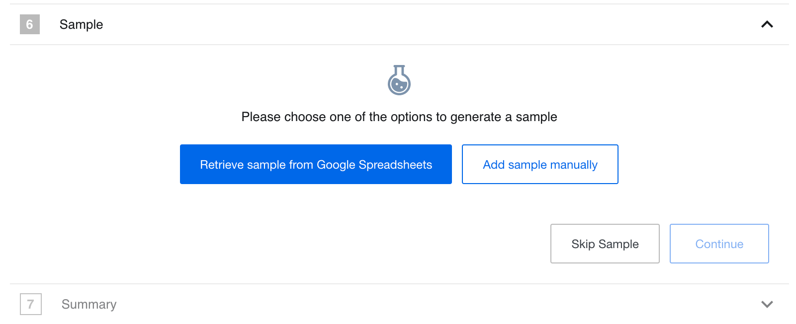
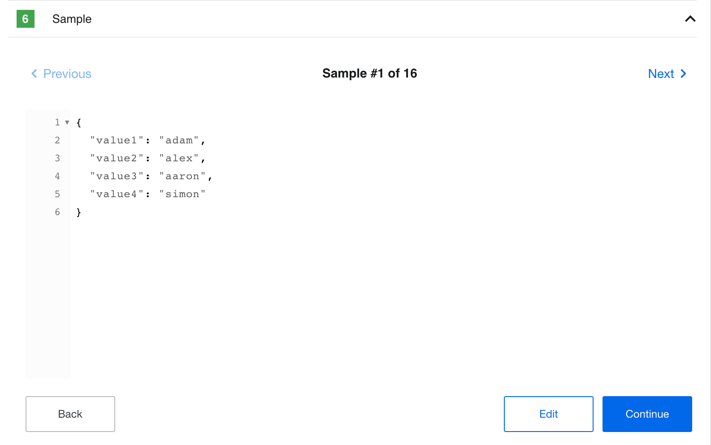
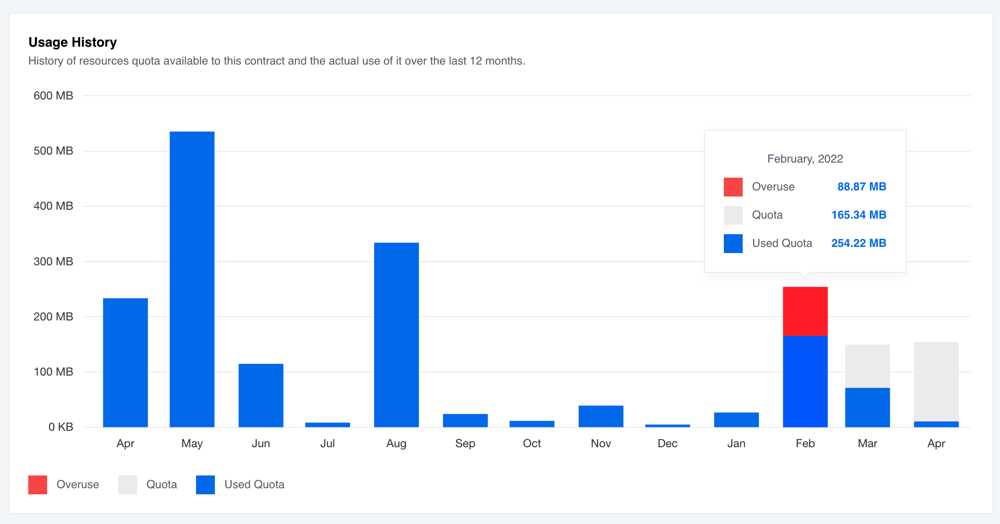
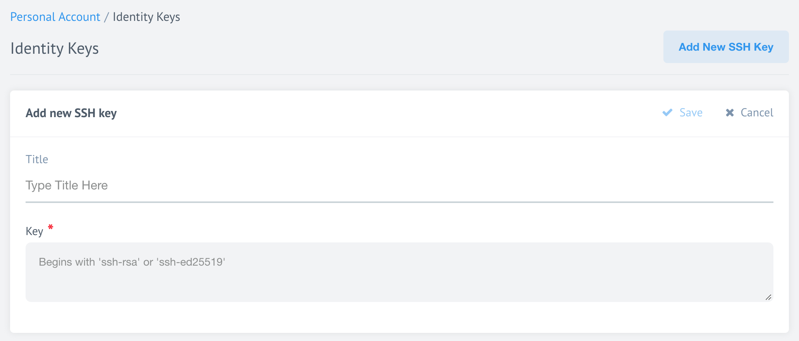
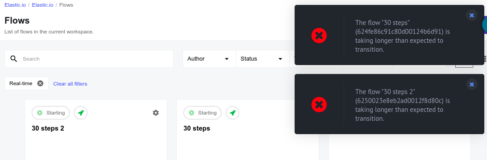

## Product update - v22.14

**Released: 2022-04-11**

*   [Improvements and Updates](#improvements-and-updates-v2214)
*   [HELM3](#helm3-v2214)
*   [Fixed bugs](#fixed-bugs-v2214)
*   [Components](#components-v2214)

### Improvements and Updates (v22.14)

#### Step designer: Sample data part (v22.14)

We have improved the sample data retrieval to provide a more unified user experience
during flow design. The look and feel is now more in line with our new approach.




The above images show the new Sample data retrieval view. This release {{page.version}}
adds new functionality, allowing users to skip sample generation by clicking on
the **Skip Sample** button. When this function is used the platform will add an
empty JSON `{}` instead of the Sample data.

When you retrieve the Sample the platform UI will show it only in JSON format. In
{{page.version}} we removed the Integrator view of Data Sample.



Here you can view the Sample, collapse different sections of the JSON data
structure and edit it.

#### Quota usage page improvements (v22.14)

To show the RAM quota overuse we improved the quota **Usage History** histogram.
If you go over the set RAM quota value the overused part will show in red.



#### SSH Keys and SSH 8.8 (v22.14)

To support the newest SSH versions we deprecated the old `ssh-dss` signature and
we added `ssh-ed25519` instead. Now when you upload your SSH key to our platform
you will see the information about the supported types of signatures.



**Please Note** the old `ssh-rsa` keys are still supported. If you want to use
them you have two options:

1.  Use an OpenSSH `8.8+` client and generate your SSH Key using the `-oPubkeyAcceptedKeyTypes=+ssh-rsa` parameter. It will generate an `RSA+SHA-2` type SSH key which provides a high level of security and works with the OpenSSH `8.8+` clients.
2.  Use an OpenSSH `<=8.7` client to generate your SSH Key.

#### Flow deletion times (v22.14)

The platform {{page.version}} includes new capability to hard-delete the flows
after an **expiration time** set by the platform management. Every time you try to
delete the flow a warning message will show with the following text:

> Are you sure you want to delete "FLOW NAME" flow permanently? Deleting this
> flow is an irreversible process, we cannot undo a deletion if you complete
> the process by accident. Please note that the credentials linked with the flow
> will not be deleted.




### HELM3 (v22.14)

We constantly improve different aspects of HELM3 deployments in collaboration
with our partners. This section lists updates and improvements done in this round.

#### Changes to `cadvisor` and `fluentd` demons (v22.14)

To enable better coexistence of platform microservices within the multi-service
Kubernetes clusters, we modified the logic used to run `cadvisor` and `fluentd` services.
The platform will run these services when the node has uniquely defined selectors.

To achieve this we introduced a new HELM3 configuration for the node labels for the
Kubernetes pod allocation.

```yaml
global:
  nodeSelectors:
    platform: "platform"
    longRunningTask: "longrunning"
    ordinaryTask: "ordinary"
```

For these changes to take affect we deprecate the following HELM3 configurations:

*   `KUBERNETES_ORDINARY_LABEL_VALUE`
*   `KUBERNETES_LONG_RUNNING_LABEL_VALUE`

These variables ware removed from the secrets HELM3 chart and are no longer used
by the `admiral` service starting from {{page.version}} release. Please use
`Values.global.nodeSelectors` platform HELM3 chart configuration instead.

*   The `cadvisor` service will run on the nodes with `longRunningTask` and `ordinaryTask` labels.
*   The `fluentd` service will run on the nodes with `platform`, `longRunningTask` and `ordinaryTask` labels.

#### Richer Ingress Management (v22.14)

To extend the Ingress setup capability we made changes in the `Handmaiden microservice`
to provide 2 new ways to provide annotations to the Ingress records. With this new
capability you can set unique Ingress values per each tenant in your cluster.

1.  [Set in the HELM3 chart](#set-helm3-configuration).
2.  [Set per tenant using an API call](#setting-via-api-call).

##### Set HELM3 configuration (v22.14)

You can set the Ingress values directly in your HELM3 chart like:

```yaml
global:
  services:
    handmaiden:
      annotations:
        kubernetes.io/ingress.class: 'nginx'
        testAnnotation: 'testValue'
```

If you set the above configuration the platform passes it to the new environment
variable `INGRESS_OPERATOR_ANNOTATIONS` used by the Handmaiden service. This adds
Ingress annotations to all tenants in your multi-tenant cluster.

##### Setting via API call (v22.14)

You can set unique Ingress annotations for each tenant using the new configuration
[while creating the tenant]({{site.data.tenant.apiDocsUri}}/v2/#create-a-tenant) via
an API call. A typical call body could look like:

```json
{
  "data": {
    "type": "tenant",
    "attributes": {
      "ingress_config" : {
        "annotations": {
          "annotationName": "value"
        }
      }
    }
  }
}
```

##### Annotation Priorities (v22.14)

Our platform will serves these annotations based on priority of annotation
the configurations (from low to high):

*   Default Ingress annotations,
*   Annotations provided in the INGRESS_OPERATOR_ANNOTATIONS environment variable,
*   Annotations, provided for the tenant using API call,
*   Static, hard-coded annotations.


#### Flow deletion job (v22.14)

Introducing a new cron job called `clear-deleted-flows` which permanently deletes
flows from the MongoDB with the `DELETED` status. Every user trying to delete a
flow will see a [warning message](#flow-deletion-times) informing that this is a
permanent and irreversible action.

##### HELM3 optional variables (v22.14)

We introduce new environment variables which you can use to control the
`clear-deleted-flows` job:

*   `WIPER_CLEAR_DELETED_FLOWS_AGE_SECONDS` - Time in seconds the job must wait before deleting the flow permanently after it is marked as `DELETED` in MongoDB. We set the default value to `86400` seconds (1 day).
*   `WIPER_CLEAR_DELETED_FLOWS_LIMIT` - Maximum number of flows the `clear-deleted-flows` job will permanently delete each time it runs.

##### Release process (v22.14)

This release process applies if you already have a cluster running previous versions
of the platform code. **The {{page.number}} release will start an automatic migration.**

*   Backup the MongoDB data base before the deployment to have an opportunity to reverse the process.
*   Set `WIPER_CLEAR_DELETED_FLOWS_LIMIT` environment variable to an applicable number for your case to perform this operation faster of you have large number of flows in your DB.

> After the migration the `marathonevents`, `requestbins` and `taskstartlogs`
> deprecated collection will be removed.

#### Iron Bank table creation on all Clickhouse instances (v22.14)

New Environment Variables:

*   `IRON_BANK_CLICKHOUSE_NODES` (required) - array of objects with host (required), port, user and password values
*   `IRON_BANK_CLICKHOUSE_DATABASE` (optional) - ClickHouse database name (default iron_bank)

```yaml
IRON_BANK_CLICKHOUSE_NODES:
   - host: "10.0.0.1"
     port: "8123"
     user: "default"
     password: "123"
   - host: "10.0.0.2"
     port: "8123"
     user: "user"
     password: "1234"
IRON_BANK_CLICKHOUSE_DATABASE: "iron_bank"
```

New Iron Bank provision logic

*   If all nodes in `IRON_BANK_CLICKHOUSE_NODES` are not available, an error is thrown and iron bank shuts down
*   If one of the nodes is not available, a warning is logged and provision to all other available nodes is executed
*   The main connection (to which all querying is executed) is set to the first available node from `IRON_BANK_CLICKHOUSE_NODES`

Removed Environment Variables:

`IRON_BANK_CLICKHOUSE_URI`




### Fixed bugs (v22.14)

*   Addressed issue when the platform token refresher service would return `500` status code in case when the `/refresh/[id]` Oauth server would return an error. Now the service reports `4xx` indicating the third party problem.
*   Fixed the bug connected with the Profile Page usage example returning `401` in case of API-Key regeneration.

### Components (v22.14)

#### [Hubspot Component](/components/hubspot/) `1.5.1` (v22.14)

*   **FIXED** the bug in `Get New and Updated Objects Polling` preventing it from extracting more than 10K records.
*   **UPDATED** sailor library to `2.6.27` version.
*   **ADDED** added the component pusher job to `Circle.ci` configuration.

#### [Salesforce Component](/components/salesforce/) `2.2.2` (v22.14)

*   **ADDED** reconnect logic on errors.
*   **UPDATED** sailor library to `2.6.27` version.
*   **ADDED** added the component pusher job to `Circle.ci` configuration.

#### [Vtex component](/components/vtex/) `1.3.0` (v22.14)

*   **ADDED** a new `Lookup Object (at Most One)` action

#### [Paypal component](/components/paypal/) `1.1.0` and `1.2.0` (v22.14)

*   **ADDED** a new `Get New and Updated Objects Polling` trigger,
*   **ADDED** a new `Lookup Object (at Most One)` action,
*   **ADDED** a new `Make a Payment` action.

#### [SOAP component](/components/soap/) `1.2.9` (v22.14)

*   **IMPROVED** Metadata generation,
*   **ADDED** a possibility to handle WSDL files where the "message" doesn't contain an element,
*   **UPDATED** the Java Sailor libraries to `3.3.9` version.

#### [SFTP component](/components/sftp/) `1.4.6` (v22.14)

*   **IMPROVED** large files handling. Now downloading file sizes bigger 10MB would not truncate the file.

#### [JDBC component](/components/jdbc/) `2.5.2` (v22.14)

*   **UPDATED** the Java Sailor libraries to `3.3.9` version.

#### [Petstore component Java](/components/petstore-java/) `1.0.4` (v22.14)

*   **UPDATED** the Java Sailor libraries to `3.3.9` version.

## Product update - v22.16

**Released: 2022-04-21**

*   [Improvements and Updates](#improvements-and-updates-v2216)
*   [OEM Related](#oem-related-v2216)
*   [Fixed bugs](#fixed-bugs-v2216)
*   [Components](#components-v2216)

### Improvements and Updates (v22.16)

#### Not enough quota to start task (v22.16)

If you are one of our many power users you might have noticed from time to time a pop-up warning
with a message **Not enough quota to start task**. These messages were not related
to your RAM quota limit. Instead these messages are triggered by real-time flows
with more than 25 steps. Because the platform initiates each step sequentially,
these errors are triggered when all flow steps cannot be initiated within the allowed time.

We have resolved this issue by ensuring that all steps (Kubernetes pods) are
initiated in parallel, thus significantly shortening the time required to start
the flow. We also changed the warning message to **The flow FLOW NAME (FLOW ID) is taking longer than expected to transition**.





### OEM Related (v22.16)

News in this section are for our customers who use
[OEM version of the elastic.io platform](https://www.elastic.io/saas-embedded-integration/).

#### Enforce 2FA use (v22.16)

Tenant administration can now enforce the 2FA during the login. We introduce a
tenant configuration flag called `forced_totp` to switch this feature on.

*   To enable `forced_totp` you must enable the `enabled_totp` as well.
*   If you remove the `enabled_totp` feature flag, system will remove `forced_totp` as well.

You can set these parameters either during the
[tenant creation]({{site.data.tenant.apiDocsUri}}/v2/#create-a-tenant)
or you can [update the parameters]({{site.data.tenant.apiDocsUri}}/v2/#update-a-tenant)
of an existing tenant via an API call. An example of such an API call is shown below.


```json
{
  "data": {
    "type": "tenant",
    "attributes":{
      "feature_flags": {
        "enabled_totp" : true,
        "forced_totp" : true
      }
    }
  }
}
```

From {{page.version}} version, the platform checks status of the `forced_totp`
parameter during your navigation of every page in the UI. If tenant administration
enforced the 2FA and you have not enabled the 2FA for your account then you will
be redirected to your profile page and presented a pop-up form to enable the 2FA.

{% include img.html max-width="30%" url="/assets/img/RN/2216/forced-totp-enable-2fa.png" title="Enable 2FA" %}



### Fixed bugs (v22.16)

*   Changed the platform behaviour when webhook would give an error when an integration flow would have adding a step after the request-reply component in the WebHook -> Request-reply flows.

### Components (v22.16)

#### [Hubspot component](/components/hubspot/) `1.5.2` (v22.16)

*   **FIXED** bug connecting with the uploading attachments


#### [Salesforce component](/components/salesforce/) `2.2.3` (v22.16)

*   **UPDATED** dependencies and addressed the packaged vulnerabilities

#### [Sftp component](/components/sftp/) `1.4.7` (v22.16)

*   **FIXED** uploading the attachments

#### [Zendesk component](/components/zendesk/) `1.0.1` (v22.16)

*   **UPDATED** Sailor version to `2.6.27`
*   **UPDATED** dependencies and addressed the packaged vulnerabilities
*   **ADDED** the component pusher job to `Circle.ci` configuration.
*   **UPDATED** `component-commons-library` version to `2.0.2`
*   **FIXED** the attachments processing

#### [Email component](/components/email/) `1.0.14` (v22.16)

*   **UPDATED** Sailor version to `2.6.27`
*   **UPDATED** dependencies and addressed the packaged vulnerabilities
*   **ADDED** the component pusher job to `Circle.ci` configuration.

#### [CSV component](/components/csv/) `3.1.2` (v22.16)

*   **UPDATED** the `component-commons-library` to read and upload attachments through the `Maester` service
*   **UPDATED** Sailor version to `2.6.27`
*   **UPDATED** dependencies and addressed the packaged vulnerabilities

#### [Request-reply component](/components/request-reply/) `1.2.3` (v22.16)

*   **UPDATED** Sailor version to `2.6.27`
*   **UPDATED** dependencies and addressed the packaged vulnerabilities
*   **ADDED** the component pusher job to `Circle.ci` configuration.

## Product update - v22.18.1

**Released: 2022-05-05**

*   [HELM3](#helm3-v22181)
*   [OEM Related](#oem-related-v22181)
*   [Components](#components-v22181)



### HELM3 (v22.18.1)

We constantly improve different aspects of HELM3 deployments in collaboration
with our partners. This section lists updates and improvements done in this round.

#### Configure login attempts (v22.18.1)

You can now configure the number of failed login attempts allowed before users are locked out of the system.
We added a new variable `MAX_LOGIN_ATTEMPTS` to the HELM3 secrets chart. You may set this variable according to your own requirements. The default value is set to five (5). Here is how we calculate this number:

*   In case you don't have 2-factor Authentication (2FA) enabled, this is the number of failed login attempts.
*   In case you have 2FA enabled, this is combined number of failed 2FA code and login attempts. This means if your user has 2FA enabled and succeeded with login but failed with 2FA more than the value of `MAX_LOGIN_ATTEMPTS` then your user will be locked out of the system. To unlock such users the tenant administration must first [disable 2FA for this user]({{site.data.tenant.apiDocsUri}}/v2/#disable-two-factor-authentication-(totp)-for-a-user) and instruct users to navigate `/forgot` address of the tenant to reset their password. This will reset the counter and user can login again.


### OEM Related (v22.18.1)

Information in this section is intended for our customers who use
[OEM version of the elastic.io platform](https://www.elastic.io/saas-embedded-integration/).

#### Removing docker registry builds on component deletion (v22.18.1)

The platform builds a component docker image every time you push a new version of
your component. When you remove the component or a particular version of it from
the platform, an associated docker build will remain until you would remove it at
later stage directly from the docker registry.

With this update we improved the situation in the following way:
*   When you remove a version of your component, the platform removes the associated docker build.
*   When you remove your component entirely, the platform removes all builds of your component.
*   We created a special tool (`remove-deleted-repos-from-docker`) to help cleanup the remnant builds. [Contact us](/admin/reporting-issue) to get a copy of this tool.
*   As an OEM customer, you must configure your own docker registry to [enable delete images option](https://docs.docker.com/registry/configuration/#delete).
*   As an OEM customer, please be aware that the deletion from docker registry does not free the memory automatically. To free the memory you would need to run the [garbage collector](https://docs.docker.com/registry/garbage-collection/) job.



### Components (v22.18.1)

#### [CSV Component](/components/csv/) `3.1.3` (v22.18.1)

*   **FIXED** `Emit Batch` behavior

#### [Woocommerce Component](/components/woocommerce/) `2.0.1` (v22.18.1)

*   **ADDED** `Raw Request` action
*   **ADDED** `Upsert Object` action
*   **ADDED** `Webhook` trigger
*   **REMOVED** `Create Object` and `Update Object` actions removed in favor the new `Upsert Object` action.
*   **ADDED** metadata information to all actions.

#### [Paypal component](/components/paypal/) `1.3.0` (v22.18.1)

*   **ADDED** `Webhook` trigger
*   **ADDED** `Create Object` action
*   **ADDED** `Update Object` action
*   **IMPROVED** the input metadata in `Make a Payment` action

#### [Vtex component](/components/vtex/) `1.4.0` (v22.18.1)

*   **ADDED** `Place Order` action

#### [MailChimp component](/components/mailchimp/) `1.0.3` (v22.18.1)

*   **ADDED** an ability to set `Ansprache` field for `Add new Subscriber` action

#### Updates to multiple components (v22.18.1)

As a part of our on-going improvements of integration components, we

*   **UPDATED** Sailor version to `2.6.27`
*   **UPDATED** dependencies and addressed the packaged vulnerabilities
*   **ADDED** the component pusher job to `Circle.ci` configuration.

Here is the list of components for {{page.version}} release.

*   [Code component](/components/code/) `1.2.8`
*   [JSONata transfer component](/components/jsonata/) `1.0.11`
*   [Router component](/components/router/) `1.0.0`
*   [Simple-trigger component](/components/simple-trigger/) `1.1.6`
*   [Splitter component](/components/splitter/) `1.4.1`
*   [WebHook component](/components/webhook/) `1.2.11`
*   [Mapper](/components/mapper/) `1.0.0`
*   [Filter component](/components/filter/) `1.1.3`
*   [REST-API component](/components/rest-api/) `1.2.19` and `2.0.12`. Both deprecated and V2 were updated.
*   [Woocommerce Component](/components/woocommerce/) `2.0.1`
*   [MailChimp component](/components/mailchimp/) `1.0.3`

## Product update - v22.20

**Released: 2022-05-19**

*   [Improvements and Updates](#improvements-and-updates-v2220)
*   [HELM3](#helm3-v2220)
*   [OEM Related](#oem-related-v2220)
*   [Fixed bugs](#fixed-bugs-v2220)
*   [Components](#components-v2220)

### Improvements and Updates (v22.20)

#### Re-authentication for sensitive actions (v22.20)

While working on the platform interface it is possible that users can accidentally
change or delete important or sensitive information.

For such cases we introduce re-authentication for sensitive actions. After
{{page.version}} for the following actions you will be asked to enter your password
to authenticate:

*   Reading, copying and regenerating your API Keys.
*   Modifying your user details.
*   Disabling 2-Factor Authentication (2FA).
*   Inviting members to contracts.
*   Inviting and removing members from workspaces.

> **Please Note**: You will be asked to re-authenticate once every 6 hours.

{% include img.html max-width="40%" url="/assets/img/RN/2220/RN2220-reauth.png" title="Sensitive action re-authentication" %}

#### Email verification during registration (v22.20)

To prevent erroneous and bot registrations we introduce email verification step to
our trial registration process. When you register first time with our platform, an email
will be sent to your given email address. Click on the link in your received email
to finish your registration. There are certain rules and restrictions to this process as well:

*   If you register using Single-Sign-on (SSO) Provider (OIDC/SAML) then the platform will not ask to verify your email address since you have verified it with your provider.
*   You must wait for 30 minutes before you can use the same email address to register.
*   The invitation to confirm your email is valid only for 1 day.

> **Please Note**: If you are invited to the platform directly, no email verification will be required.



### HELM3 (v22.20)

We constantly improve different aspects of HELM3 deployments in collaboration
with our partners. This section lists updates and improvements included in this release.

#### Separate MongoDB for Maester (v22.20)

When your integration flow needs to transfer big objects or attachments, one of
the platform microservices called Maester temporarily stores them in MongoDB while
passing only the object IDs through the integration flow steps.

Starting from {{page.version}}, you can use a dedicated database for storing Maester
objects and the run-time attachments. To configure, add `MAESTER_MONGO_URI`
environment variable to HELM3 secrets charts and set it to target this new database.

> Note: You will need to migrate the grids to new MongoDB as well to ensure the Maester
> object availability after implementation.

Organisations who do not need a separate MongoDB instance to store their Maester
objects should set the `MAESTER_MONGO_URI` variable to the same value as the
`MONGO_URI` variable. This will save objects in your main database.

#### Setting authentication token lifetime (v22.20)

To configure the [re-authentication for sensitive actions](#re-authentication-for-sensitive-actions):
*   Add the `SENSITIVE_ACTION_AUTH_LIFETIME` environment variable to HELM3 secrets chart and set it to specify how long user authentications are valid. The system expect the value of this parameter in **milliseconds**. The default is set to 21600000 (6 hours).
*   Enable the `tenant.featureFlags.sensitiveActionsReauth` feature flag (set it to `true`).

### OEM Related (v22.20)

Information in this section is intended for our customers who use
[OEM version of the elastic.io platform](https://www.elastic.io/saas-embedded-integration/).


#### White-labeled credential management (v22.20)

Developing integrations requires a certain level of access to business systems.
In cases where the integrators are not responsible for these systems it is critical
that only secure access is allowed and that system admins can control credentials
used To solve the dilemma we introduce **White-labeled credential management**
feature.

##### How does the White-labeled credential management work? (v22.20)

As an integrator you provide a unique URL to the credential holder to enter their access credentials without
registering or logging-in to the system. The access holder is presented an interface
to enter their credentials, verify them and save.

{% include img.html max-width="100%" url="/assets/img/RN/2220/RN2220-create-credential.png" title="OEM Create Credential" %}

In addition they can modify the existing credentials as well.

{% include img.html max-width="100%" url="/assets/img/RN/2220/RN2220-modify-credentials.png" title="OEM Modify Credentials" %}

For both cases they are presented with a simple screen to work with only the
specified credentials.

##### How to generate unique URL? (v22.20)

There are certain preconditions before you can enable this feature:

*   The end customer is already in the DB. This means you have to [create a user]({{site.data.tenant.apiDocsUri}}/v2/#create-a-user) for your credential holder, then [add him/her to the contract]({{site.data.tenant.apiDocsUri}}/v2/#add-a-new-member-to-the-contract's-scope) and [workspace]({{site.data.tenant.apiDocsUri}}/v2/#add-a-new-member-to-workspace) where the integration is to be developed. All these actions you can do with API calls using administrative access.
*   The newly created user must have only access to the credentials entity.
*   Your tenant has SSO provider (OIDC/SAML) with `autoCreateUsers` set to `false`.

Once the above conditions are met you can take the following steps to generate
the URL to request credentials from their owner:

The initial URL has a form `/embedded-credentials/repoId` where the `repoId`
would be the ID of component for which you need to set the credential. Then you
would need to add the following query parameters to this URL:

*   `workspaceId` (required) - this is the ID of the workspace where integration is set.
*   `ssoProviderType` (optional) - values can be `SAMLProvider` or `OIDCProvider`.
*   `ssoProviderId` (optional) - this is the ID of your SSO provider.

Let us construct the URL:
`TENANT_URL/embedded-credentials/[repoId]?workspaceId=[workspaceId]&ssoProviderType=[ssoProviderType]&ssoProviderId=[ssoProviderId]`

If you do not specify `ssoProviderType` and `ssoProviderId` then they will be
automatically taken from the `tenant.loginRedirectSsoProvider` property but only if this is defined.

#### Setup Email verification (v22.20)

To set the [email verification process](#email-verification-during-registration)
in your tenant the following must be done using an [API call]({{site.data.tenant.apiDocsUri}}/v2/#update-a-tenant) to update your tenant records using `tenantAdmin` privileges:

*   Enable the registration page - set the `attributes.hide_register` parameter to `false`.
*   Use `signin_v_2` type - add the `attributes.signin_v_2` attribute containing the URL of the provider logo using the `attributes.signin_v_2.logo_url` tenant parameter.
*   Enable `email_verification` feature flag (**NEW**) - set `attributes.feature_flags.email_verification` to `true`.



### Fixed bugs (v22.20)

*   Fixed the error `Cannot add property token, object is not extensible` appears in the platform user interface when trying to evaluate JSONata expressions with `"$count()"`.

### Components (v22.20)

#### [PayPal Component](/components/paypal/) `1.3.0` (v22.20)

*   **ADDED** `Receive Instant Payment Notification` trigger
*   **ADDED** `Receive Payment Data Transfer` trigger
*   **ADDED** `Webhook` trigger
*   **ADDED** `Create Object` action
*   **ADDED** `Update Object` action
*   **IMPROVED** input metadata in the `Make a Payment` action


#### [Microsoft One Drive Component](/components/onedrive) `1.0.5` (v22.20)

*   **UPDATED** the `component-commons-library` to read and upload attachments through the `Maester`
*   **UPDATED** Sailor version to `2.6.27`
*   **UPDATED** dependencies and addressed the packaged vulnerabilities

#### [Shopify Admin Component](/components/shopify/) `1.6.0` (v22.20)

*   **ADDED** validation `HMAC` signature for the `Webhook subscription` trigger

#### [Petstore Component Java](/components/petstore-java/) `1.0.6` (v22.20)

*   **IMPROVED** the security by adding an automated vulnerability check run in CI/CD

#### [JDBC Component](/components/jdbc/) `2.5.4` (v22.20)

*   **IMPROVED** the security by adding an automated vulnerability check run in CI/CD

#### [Vtex Component](/components/vtex/) `1.4.1` (v22.20)

*   **ADDED** `Place Order` action
*   **UPDATED** dependencies and addressed the packaged vulnerabilities
*   **ADDED** the component pusher job to `Circle.ci` configuration.

#### [CSV Component v3](/components/csv/) `3.1.4` (v22.20)

*   **FIXED** memory leak on `Emit Batch` behavior for the `Read CSV attachment` action

#### Updates to multiple components (v22.20)

As a part of our on-going improvements of integration components, we

*   **UPDATED** Sailor version to `2.6.27`
*   **UPDATED** dependencies and addressed the packaged vulnerabilities
*   **ADDED** the component pusher job to `Circle.ci` configuration.

Here is the list of components for {{page.version}} release.

*   [Marketo component](/components/marketo/) `2.2.4`
*   [AWS S3 Component](/components/aws-s3) `1.4.3`
*   [HJSON Component](/components/hjson/) `1.0.1`
*   [Zoho CRM Component](/components/zoho-crm/) `1.3.2`
*   [Git Protocol Component](/components/git-protocol/) `1.1.3`
*   [Google Spreadsheets](/components/gspreadsheet/) `2.0.2`
*   [Salesforce Component v1](/components/salesforce/) `1.3.9`
*   [Salesforce Component v2](/components/salesforce/) `2.2.2` and `2.2.3`
*   [Simple Trigger Component](/components/simple-trigger/) `1.1.6`
*   [Delta Detection Component](/components/delta-detection/) `2.0.3`
*   [Utility Component](/components/utility/) `1.4.1`
*   [Magento2 Component](/components/magento2/) `1.6.6`
*   [GraphQL Component](/components/graphql/) `1.1.2`
*   [Pub-Sub Component](/components/pub-sub/) `1.0.8`
*   [MongoDB Component](/components/mongodb/) `1.5.9`
*   [CSV Component Old](/components/csv/) `2.2.1`
*   [Dictionary Component](/components/lookup-table/) `1.1.6` a.k.a Lookup Table Component
*   [ZIP Component](/components/zip/) `1.1.5`
*   [XML Component](/components/xml/) `1.3.5`
*   [Meracdo Pago Component](/components/mercado/) `1.0.1`

## Product update - v22.22

**Released: 2022-06-02**

*   [Announcements](#announcements-v2222)
*   [Features](#features-v2222)
*   [Improvements and Updates](#improvements-and-updates-v2222)
*   [HELM3](#helm3-v2222)
*   [OEM Related](#oem-related-v2222)
*   [Fixed bugs](#fixed-bugs-v2222)
*   [Components](#components-v2222)

### Announcements (v22.22)



#### ISO 27001 certification (v22.22)

> **We are ISO 27001 certified!** Check our
> [dedicated page](/admin/iso27001-certification) for more details and to download
> the copy of our certificate.

#### Temporary Duplication of Execution Numbers (v22.22)

As part of ongoing improvements we have refined our system architecture around
executions to decrease latency when loading the executions page. As part of these
changes there is a temporary duplication of the number of executions recorded in
your executions page. No data is lost, there is no influence on quota consumption, and
these duplications will disappear as we end the transition phase in approximately
30 days. If you have any questions please contact our support directly.

#### Attachment/object processing and storing (v22.22)

We are changing policies for our retention services. As platform traffic grows
the resource burden of retaining files becomes significant.

*   The attachment and object (a.k.a. `lightweight objects`) retention period is reduced to 3 days (72 hours)
*   The maximum attachment/object size is capped at 100 MB.



### Features (v22.22)

#### Flow designer header (v22.22)

To provide more vertical space during the flow design process we changed the flow
designer header behaviour. Now when the left-hand-side menu is closed the action
buttons and statuses merge into the same line with flow title and description.

{% include img.html max-width="100%" url="/assets/img/RN/2222/RN2222-flow-header-change.gif" title="Flow designer header" %}

When your flow title or description is larger than the available space the visible
text is cropped. By hovering over these fields you can reveal the full text.

{% include img.html max-width="80%" url="/assets/img/RN/2222/RN2222-hover-message.png" title="Hover to see the description" %}

### Improvements and Updates (v22.22)

#### Copy code blocks from published flows (v22.22)

Reusing mappings or code snippets from published flows can accelerate flow development.
You can now select and copy such text from your published flows without first
making a draft of the flow. This feature includes:

*   Any mapping (including JSONata transform views)
*   The selected data sample
*   Any code from the code component
*   Data from retrieved sample

Example shows copied code from the Node.js code component configuration view:

{% include img.html max-width="80%" url="/assets/img/RN/2222/RN2222-copy-code.png" title="Copy code blocks" %}

#### Credential ID permanently shown (v22.22)

Now you can see the IDs of any credentials while browsing through the list of
credentials in the Integrate > Credentials > Component Name view:

{% include img.html max-width="80%" url="/assets/img/RN/2222/RN2222-credentials-page-ID.png" title="Credential ID in Credentials page" %}

Or while configuring a step in your integration flow:

{% include img.html max-width="80%" url="/assets/img/RN/2222/RN2222-flow-step-ID.png" title="Credential ID in Flow designer" %}


#### REST-API component header configuration (v22.22)

We now obfuscate authentication header values for the REST-API-V2 component. You
will notice this in the Configuration view when `basic` or `api-key` authentication is used.

{% include img.html max-width="80%" url="/assets/img/RN/2222/RN2222-rest-api-cred.png" title="REST-API-V2 credential" %}


#### Re-authentication for sensitive actions (continuation) (v22.22)

This is part 2 of our initiative to prevent accidental or malicious changes to
sensitive data and follows on from release
[22.20](/releases/2022Q2#re-authentication-for-sensitive-actions-v2220).

This time we extend the list of actions for which you will be asked to enter your
password to authenticate:

*   Change user roles in Contracts and Workspaces.
*   Add or remove SSH Keys.
*   Remove member from Contract.

> **Again, please note**: You will be asked to re-authenticate once every 6 hours.




### HELM3 (v22.22)

We constantly improve different aspects of HELM3 deployments in collaboration
with our partners. This section lists updates and improvements included in this release.


#### Enforcing Maester object size (v22.22)

We introduce a new variable (`MAESTER_MAX_SIZE_PER_OBJECT` in bytes) you can use to control
the maximum object size accepted by the Maester service. The default maximum value
is set 1GB. The recommended range is from 100MB to 1GB.


### OEM Related (v22.22)

Information in this section is intended for our customers who use
[OEM version of the elastic.io platform](https://www.elastic.io/saas-embedded-integration/).

#### Email domain blacklist (v22.22)

If your tenant has an an open registration page then you can block registration
from any domain by adding it into the domain blacklist. For this to work in your
tenant, make an [API call]({{site.data.tenant.apiDocsUri}}/v2/#update-a-tenant)
to update your tenant records using `tenantAdmin` privileges:

*   Enable the registration page - set the `attributes.hide_register` parameter to `false`.
*   Add records to the blacklist - create the `attributes.email_domains_blacklist` record to contain comma separated domain names in an array object like `["example.com", "foo.bar"]`.

#### Email verification with regular signup page (v22.22)

During the 20.20 platform release we introduced [email verification process](/releases/2022Q2#email-verification-during-registration-v2220) which worked only when the [`signin_v_2` were used](/releases/2022Q2#setup-email-verification-v2220).

Now you can use the email verification process even if you are using a regular
signup page in your tenant. To enable this feature in your tenant the following
steps must be done using an [API call]({{site.data.tenant.apiDocsUri}}/v2/#update-a-tenant)
to update your tenant records using `tenantAdmin` privileges:

*   Enable the registration page - set the `attributes.hide_register` parameter to `false`.
*   Enable `email_verification` feature flag - set `attributes.feature_flags.email_verification` to `true`.



### Fixed bugs (v22.22)

*   Fixed the user interface bug connected with slow loading of the executions page for workspaces containing executions belonging to a deleted user's flows. Now you will see `[Deleted User]` instead.
*   Fixed the bug when `"Cannot perform 'get' on a proxy that has been revoked"` error was shown after evaluation of the JSONata mapping expression.
*   Fixed the Dashboard bug connected with the overlapping axis lines and values.
*   Fixed the bug when Flow Page would not load in case the aggregated flow versions document would exceed 16MB limit in MongoDB.

### Components (v22.22)

#### [REST API V2 component](/components/rest-api/) (v22.22)

*   **IMPROVED** the use of platform secrets

#### [HJson component](/components/hjson/) `1.0.2` (v22.22)

*   **FIXED** the attachments URL

#### [Delta-detection Component](/components/delta-detection/) `2.1.0` (v22.22)

*   **ADDED** `Write Entire Bucket Contents` action
*   **ADDED** `Read Entire Bucket Contents` action

#### [utility component](/components/utility/) `1.4.2` (v22.22)

*   **ADDED** `Network Diagnostics` action

#### [Ipaas Core component](/components/ipaas-core/) `1.4.0` (v22.22)

*   **UPDATED** `Lookup Flow Hydrates Component Version Info`- making this view dynamic
*   **UPDATED** `Upsert Flow Handles Matching on Semantic Versions` - making this view dynamic
*   **UPDATED** `Lookup Flow Hydrates Pub-Sub Topic Info` - making this view dynamic

#### [Zoho CRM component](/components/zoho-crm/) `1.3.4` (v22.22)

*   **FIXED** the attachment processing
*   **FIXED** set the node engine to `16.x` (addresses error with Verify Credentials)
*   **ADDED** environment variable `MAX_FILE_SIZE` to control attachment size limit
*   **UPDATED** component dependencies

#### [Magento2 component](/components/magento2) `1.6.7` (v22.22)

*   **ADDED** support for Magento2 versions `2.4.4`
*   **FIXED** the integration tests

#### Ukraine-alert component `1.0.0` (v22.22)

*   **NEW** component to receive raid alerts notifications in Ukraine
*   **ADDED** new `Get Ukraine Alerts Polling` trigger
*   **ADDED** new `Webhook` trigger

#### [Google spreadsheet component](/components/gspreadsheet) `2.0.3` (v22.22)

*   **IMPROVED** configuration of the timing of calls is now available in the Credentials step
*   **ADDED** configuration of retry attempts to the Credentials step
*   **ADDED** retry logic that helps prevent `Quota exceeded` errors

#### [Docuware component](/components/docuware) `1.1.1` (v22.22)

*   **FIXED** bug with data shown in "Search dialog to use" field
*   **FIXED** attachments Url

#### [JDBC component](/components/jdbc) `2.5.5` (v22.22)

*   **UPDATED** connection parameter `connectionTimeZone` now defaults to `SERVER` for MySQL connections


#### [Paypal component](/components/paypal/) `1.3.1` (v22.22)

*   **ADDED** duplicate check of incoming message for Receive IPN message trigger

#### [SFTP component](/components/sftp/) `1.4.8` (v22.22)

*   **FIXED** memory leak for `Download Files/File by name` actions and `Read Files` trigger
*   **UPDATED** component dependencies

#### [Salesforce component](/components/salesforce/) `2.2.4` (v22.22)

*   **ADDED** timeout mechanism which allows to retry never-ending requests

## Product update - v22.24

**Released: 2022-06-21**

*   [Improvements and Updates](#improvements-and-updates-v2224)
*   [Fixed bugs](#fixed-bugs-v2224)
*   [Components](#components-v2224)

### Improvements and Updates (v22.24)

#### Change of Footer position (v22.24)

To extend vertical space of the flow designer screen we moved the Footer to the
bottom of side-menu. You can now see the platform version, Privacy Policy and ToS
links by opening the menu.

{% include img.html max-width="30%" url="/assets/img/RN/2224/RN2224-new-footer-design.png" title="New footer design" %}

#### Re-authentication for sensitive actions (final part) (v22.24)

This is the 3rd and final part of our initiative to prevent accidental or malicious
changes to sensitive data and follows on from releases [22.20](/releases/2022Q2#re-authentication-for-sensitive-actions-v2220) and [22.22](/releases/2022Q2#re-authentication-for-sensitive-actions-continuation-v2222).

In this final part we extend re-authentication for sensitive actions to support
cases when a user logs in using OIDC/SAML. The user will be redirected to OIDC/SAML
provider for authentication.

> **Again, please note**: You will be asked to re-authenticate once every 6 hours.

This feature will work on all modern web browsers versions from:

*   Chrome `66+`
*   Firefox `63+`

#### Component development and custom Dockerfile (v22.24)

To improve component deployment and build process we modernised the `appbuilder`
and `apprunner` docker images to address potential vulnerabilities in the `Node.js`
packages. All platform services, as well as the `Node.js` based integration components
are built with these images.

The modernisation brought some important changes which might affect you when you
deploy the new version of your component code.

*   You can use a custom `Dockerfile` to define the build process in the `Node.js` components. It must be in the root directory of your component code.
*   If you have previously used a custom `Dockerfile` you might have noticed that it was not used in the build process. Now the build process **will check for the existence of it and use it**. Which means if you have not updated your `Dockerfile` recently, chances are your component build might fail or the newly built component might not function as expected. **Check your `Dockerfile` before deploying or remove it from the component code if custom build parameters are not necessary.**
*   We now support `Node.js` version 18.
*   **IMPORTANT**: custom `Dockerfile` is not yet supported for Java components.

### Fixed bugs (v22.24)

*   Fixed the bug in the object and attachment handling service. Now the service will retry streams on failure and will handle errors properly.
*   Fixed the user interface bug when the required field symbol (`*`) would not show after the metadata reload in case the mandatory fields were controlled by a checkbox.

### Components (v22.24)

#### [Salesforce Component v2](/components/salesforce/) `2.2.4` and `2.3.0` (v22.24)

*   **ADDED** new `Type Of Search` - `External IDs` to `Upsert Object` action
*   **ADDED** caching for metadata in the `Upsert Object` action (metadata needs to find fields that contain attachment)
*   **ADDED** timeout for `Upsert Object` action

#### [REST API Component v2](/components/rest-api/) `2.0.13` (v22.24)

*   **IMPROVED** secrets only load once per container lifetime (per token expiration time in case of OAUTH2)

#### [Vtex Component](/components/vtex/) `1.4.2` (v22.24)

*   **ADDED** `Last interaction` option to `Time stamp field to poll on` in `Get New And Updated Objects Polling` trigger
*   **IMPROVED** `Get New And Updated Objects Polling` trigger to use [scroll](https://developers.vtex.com/docs/guides/search-and-scroll-api-queries) instead of [search](https://developers.vtex.com/docs/guides/search-and-scroll-api-queries) to collect all records

#### [HJSON Component](/components/hjson/) `1.0.2` (v22.24)

*   **FIXED** url in attachment

#### [Delta Detection Component](/components/delta-detection/) `2.1.0` (v22.24)

*   **ADDED** `Read Entire Bucket Contents` action
*   **ADDED** `Write Entire Bucket Contents` action

#### [Utility Component](/components/utility/) `1.5.0` (v22.24)

*   **ADDED** `Network Diagnostics` action

#### [IPass Core Component](/components/ipaas-core/) `1.4.0` (v22.24)

*   **IMPROVED** flow with `pubSubTopicName` at actions `Lookup Object By Unique Criteria` and `Lookup Objects (plural)`
*   **ADDED** logic to handle matching Pub-Sub topics at actions `Upsert Object By Unique Criteria`
*   **IMPROVED** flow with `componentSemanticVersion` at actions `Lookup Object By Unique Criteria` and `Lookup Objects (plural)`
*   **ADDED** logic to handle matching on Semantic Versions at actions `Upsert Object By Unique Criteria`

#### [Ukraine Alerts Component](/components/ukraine-alerts/) `1.0.0` and `1.0.1` (v22.24)

*   **ADDED** retries to every API call
*   **ADDED** `Get Ukraine Alerts Polling` Trigger
*   **ADDED** `Webhook` Trigger

#### [Zoho CRM Component](/components/zoho-crm/) `1.3.3` and `1.3.4` (v22.24)

*   **ADDED** `version` field to the component.json file
*   **FIXED** attachment processing
*   **IMPROVED** set node engine to 16.x (fix error with "Verify Credentials")
*   **ADDED** ENV `MAX_FILE_SIZE` to control attachment size limit
*   **IMPROVED** upgrade `component-commons-library` to v2.1.0


#### [Magento2 Component](/components/magento2/) `1.6.7` (v22.24)

*   **ADDED** support for Magento2 versions 2.4.4
*   **FIXED** integration tests

#### [Shopify Component](/components/shopify-admin/) `1.6.1` and `1.6.2` (v22.24)

*   **ADDED** information about required permissions for the credential verification
*   **IMPROVED** more info in logs if got errors

#### [ID Linking Component](/components/id-linking/) `1.1.0` (v22.24)

*   **ADDED** `Write Entire Bucket Contents` Action
*   **ADDED** `Read Entire Bucket Contents` Action
*   **FIXED** label names for `Upsert Object` input metadata

#### [SFTP Component](/components/sftp/) `1.4.9` (v22.24)

*   **ADDED** file filter to the `Poll Files` trigger

#### [Xero Component](/components/xero/) `1.0.0` (v22.24)

*   **ADDED** `Make Raw Request` action

#### [Email Component](/components/email/) `1.2.0` (v22.24)

*   **ADDED** support for attachments from metadata. The metadata now is shown in the body.
*   **FIXED** how the component handles incoming Arrays. Now it stringifies the JSON bodies by default preserving the strings, numbers, and booleans.
*   **NEW** main library for sending emails (old one is now deprecated).
*   **IMPROVED** the code by migration to `TypeScript`.

## Product update - v22.26

**Released: 2022-06-30**

*   [Improvements and Updates](#improvements-and-updates-v2226)
*   [OEM Related](#oem-related-v2226)
*   [Fixed bugs](#fixed-bugs-v2226)

### Improvements and Updates (v22.26)

#### Node.js Sailor version `2.6.28` (v22.26)

A new version of the Node.JS Sailor library `2.6.28` is released. For Users who
develop their own components using our SDKs this update provides improved handling
of any errors generated by the Maester service during upload of lightweight messages.

#### Edit Snapshot button always present (v22.26)

With this release it is now possible to to set and edit [snapshots](/developers/snapshot-overview)
while the flow is in Draft status - flows no longer need to have the status
`Published` or have been executed.

{% include img.html max-width="80%" url="/assets/img/RN/2226/RN2226-snapshot.png" title="Edit Snapshot always available" %}




### OEM Related (v22.26)

Information in this section is intended for our customers who use
[OEM version of the elastic.io platform](https://www.elastic.io/saas-embedded-integration/).

#### Email domain blacklist (continuation) (v22.26)

This is further improvement of email domain blacklist feature from [22.22](/releases/2022Q2#email-domain-blacklist-v2222)
release. Now you can use a wildcard character (`*`) with a domain name to exclude
all variants, for example `gmail.*`, `yahoo.*`, etc.




### Fixed bugs (v22.26)

*   Fixed the issue which enabled data sample editing in read-only mode of the flow designer. To edit data samples you must press edit first to make changes.
